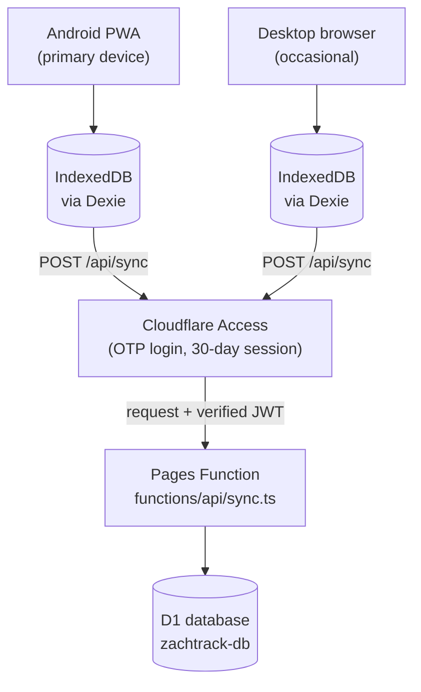

# ZachTrack - Architecture & Project Notes

This is the "reassociate yourself with the project" document. `README.md`
covers what the app does and how to run it; this file covers **why it's
built the way it is**, the sync architecture end-to-end, real issues hit
during implementation (and their fixes), the exact Cloudflare resources that
exist today, and what's been discussed but not built yet.

## 1. System overview

ZachTrack is local-first: every read/write goes through Dexie (IndexedDB) on
the device, and the UI never blocks on the network. A separate sync layer
pushes/pulls against a private Cloudflare backend, gated by Cloudflare
Access so the app and its data are invisible to anyone but the owner.



Nothing reaches `sync.ts` or D1 without first passing Cloudflare Access's
login check on the app's custom domain (`app.example.com` in these docs) - there is no separate
username/password/session system in application code at all.

## 2. Data model (current, exact)

From `src/lib/db/types.ts`. Every syncable record now carries a stable id and an
`updatedAt` used for last-write-wins conflict resolution.

```ts
interface FastRecord {
  id?: number;          // Dexie's local auto-increment id -- NOT synced, NOT globally unique
  uuid: string;         // stable id used for sync (added specifically to support this)
  startTime: number;
  startDay: number;     // start-of-day(startTime); app-level one-fast-per-day uniqueness
  endTime?: number;
  method: 'preset' | 'custom';
  presetId?: string;
  presetLabel?: string;
  targetHours?: number;
  moodRating?: number;
  energyRating?: number;
  hungerRating?: number;
  tags?: string[];
  note?: string;
  createdAt: number;
  updatedAt: number;
}

type FieldKind = 'number' | 'rating' | 'boolean';
type FieldAggregation = 'sum' | 'average' | 'last';  // how same-day entries combine for charts/stats; undefined = 'last'

interface FieldDefinition {
  id: string; name: string; kind: FieldKind;
  unit?: string; ratingMin?: number; ratingMax?: number;
  aggregation?: FieldAggregation;
  createdAt: number;
  updatedAt: number;    // added for sync; name, unit, rating max and aggregation are editable (3.14)
}

type TrackableDisplayMode = 'occurrences' | 'ages' | 'event' | 'measurement' | 'daily' | 'checkin';  // 3.17

interface TrackableDefinition {
  id: string; name: string; icon: string; color: string;
  fieldIds: string[];
  displayMode?: TrackableDisplayMode;  // 'ages' = people/birthdays, see Section 3.9
  createdAt: number;
  updatedAt: number;
}

interface TrackableEntry {
  id: string; trackableId: string; timestamp: number;
  note?: string; tags?: string[];
  values?: Record<string, number | boolean>;
  createdAt: number;
  updatedAt: number;
}

interface SettingsRecord {
  id: 'app-settings';
  defaultPresetId: string; notificationsEnabled: boolean;
  heightInches?: number; goalWeightLb?: number;
  weightFieldId?: string; // the field BMI and the goal line follow (3.14)
  waistFieldId?: string; neckFieldId?: string; hipFieldId?: string; // Navy body fat (3.15)
  bodyFatSex?: 'male' | 'female';
  updatedAt: number;      // added for sync
}
```

**Sync-support-only tables** (never surfaced in any UI, purely plumbing):

```ts
/** Short-lived local record of a hard delete, kept only until the server acks it. */
interface SyncTombstone {
  id?: number;
  recordType: 'fasts' | 'fieldDefinitions' | 'trackableDefinitions' | 'trackableEntries';
  uuid: string;
  deletedAt: number;
}

/** Singleton row tracking this device's pull cursor. */
interface SyncMeta {
  id: 'sync';
  cursor: number;        // last server-assigned serverSeq this device has seen
  lastSyncedAt?: number;
}
```

Dexie is at schema **version 7** (v7 adds the task tables, 3.59). Version 4's
migration backfilled `uuid` for existing fasts and `updatedAt` for existing
field definitions/settings - additive, no data loss, same pattern as the v2
`startDay` migration before it. The task records (`TaskProject`, `Task`,
`TaskCompletion`) are described in 3.59.

The **D1 (remote) schema** (`d1/schema.sql`) mirrors these almost exactly,
with the same field names (camelCase, not snake_case - a deliberate choice
so the wire format, local Dexie shape, and D1 columns all match 1:1 with
minimal translation code). Two differences worth knowing:
- Every D1 table adds `deletedAt` (soft-delete) and `serverSeq` (sync
  ordering) columns that have no local Dexie equivalent - see Section 3.6.
- `TrackableEntry.values` is stored in the `fieldValues` column server-side,
  because `VALUES` is a reserved SQL keyword. The sync endpoint's wire
  format still calls it `values` and translates it at the boundary.

## 3. Why it's built this way

### 3.1 D1, not R2, for the backend store
A simpler "dump the whole IndexedDB as one JSON blob into R2" was
considered and rejected early on: R2 only supports whole-blob last-write-wins,
which risks silently losing changes if two devices edit *different* records
before either syncs. D1 allows per-record conflict resolution, and the data
is genuinely relational.

### 3.2 Cloudflare Access, not custom auth code
Single-user personal app - gate the whole custom domain behind Cloudflare
Access (Zero Trust) rather than write any password/session/JWT code. Access
handles the entire login UX (email one-time-PIN, no external identity
provider needed) and only lets the owner's email (`OWNER_EMAIL`) through.

The sync endpoint *also* checks identity itself, because Access does not
cover every hostname that can reach the Function (see 4.6). See Section 4.2:
the friendly `Cf-Access-Authenticated-User-Email` header turned out not to be
reliably injected for Pages Functions, so the check reads the
`Cf-Access-Jwt-Assertion` header (the raw signed JWT) instead, and verifies
it the way Cloudflare documents (see 4.11): RS256 signature against the
team's published keys, issuer, expiry, optional audience tag, and the email
claim against `OWNER_EMAIL`. If `OWNER_EMAIL` or `ACCESS_TEAM_DOMAIN` is not
set, every request is refused (fail closed).

### 3.3 Cloudflare Pages + Pages Functions, one project
`/api/sync` is a Pages Function, not a separate Worker project - one
deployable unit serves the static PWA and the sync endpoint together.
Deployed via **direct upload** (`wrangler pages deploy`), not a git-connected
project: a direct-upload Pages project can't be switched to git integration
later, and deploying by hand at release time keeps production on tagged
versions only.

### 3.4 Send what changed, with a daily full send
Until v1.10.0 the client sent its entire local dataset on every sync and let
the server's "upsert only if incoming `updatedAt` is newer" logic no-op the
unchanged records. That was simple, but every sync grew with the data, and
the history could only say what came *down*, since "sent" was always
everything.

Now `SyncMeta.sentThrough` holds the local time the last successful sync
started, and a sync sends only records with `updatedAt` at or after it
(`getChangedSyncableRecords` in `db/sync.ts`). Both sides of that comparison are
this device's own clock, so another device's clock doesn't matter. Edits made
while a sync is in flight have an `updatedAt` after its start, so the next
sync picks them up. Three things keep it honest:

- **Retry:** records the server refused are kept in `SyncMeta.retry` and sent
  again every sync, so they keep showing as "not synced" until fixed.
- **Import:** imported records keep their own, usually older, `updatedAt`, so
  an import sets `fullSendRequestedAt` and the next sync sends everything.
- **Daily full send:** the first sync on a device, and any sync more than 24
  hours after the last full send, sends everything (`FULL_SEND_EVERY_MS`), as
  a safety net for anything that slipped past: a clock set back, a server
  restored from a backup.

A full send is still one request, which is why the batching from Section 4.1
matters. The server reports what it actually stored (`appliedCounts`, and
the first 50 as `applied`), using D1's `meta.changes` per statement, so a
copy the server already had isn't counted as sent.

The pull leaves out the rows the request itself wrote (the `serverSeq` block
reserved for it, `ownSeq`), so "received" means changes from other devices.
A row another device changed after this request wrote it has a newer
`serverSeq` and still comes through.

### 3.5 Server-assigned sequence cursor, not a timestamp cursor
The *pull* side ("what changed on the server since I last looked") uses a
monotonically increasing integer (`serverSeq`, tracked in a single-row
`syncSeq` table, incremented atomically per write) rather than a wall-clock
timestamp. This sidesteps an entire class of subtle bugs from clock skew or
two writes landing in the same millisecond, which a timestamp-based cursor
would be vulnerable to. `updatedAt` (client clock) is still used for
last-write-wins comparison *between* two versions of the same record - that
part is unaffected.

### 3.6 Soft-delete on the server, hard-delete + short-lived tombstone on the client
This was a deliberate hybrid, not the tombstones-vs-soft-delete either/or
originally framed:
- **Locally**, every delete function in `db/` still does a real, immediate
  hard delete - exactly as before sync existed. This means **zero changes**
  were needed to any existing query/read path anywhere in the app (routes,
  components, charts) - a huge reduction in risk surface compared to making
  every local read filter out soft-deleted rows.
- Each hard delete also writes a row to the local-only `syncTombstones`
  table, which exists purely to tell the server "this was deleted" on the
  next push. Once the server acknowledges it, the tombstone is pruned.
- **On the server**, a delete is just an ordinary LWW-compared field update
  (`deletedAt` set, compared the same way as any other column) - no special
  delete endpoint or code path.
- When a device **pulls** a server-side delete it didn't originate, it
  performs a real local hard delete and does **not** write a new tombstone
  for it (that would just bounce the delete back and forth forever).

### 3.7 One-fast-per-day conflict handling
D1 has a real `UNIQUE INDEX` on `(startDay) WHERE deletedAt IS NULL` as a
last-resort safety net, but the actual conflict *avoidance* happens in
memory: one query fetches all current non-deleted `(uuid, startDay)` pairs,
then each incoming fast is checked against that map before being included in
the batch upsert (see 3.8 for why this is a map lookup and not a per-record
query). A genuine conflict (two different fasts claiming the same day) gets
excluded from the upsert and reported back in the sync response's `rejected`
array. The client surfaces this as a small warning `N` badge on the sync status
pill - deliberately **no automatic merge**; this is a rare-enough edge case
for a single personal user that a surfaced, manually-resolved conflict is
safer than guessing which side should win.

### 3.8 Batched D1 writes via a reserved sequence range
Every sync request that has records to write does, at most: one query to
reserve a contiguous block of `serverSeq` values (`UPDATE syncSeq SET value
= value + ? ... RETURNING value`), one query to fetch existing fast
`(uuid, startDay)` claims, and up to eight `db.batch([...])` calls (one per
table) - regardless of how many records are actually being synced. This
exists because of a real production bug; see Section 4.1 for the story.

### 3.9 Ages/birthdays as a `displayMode` flag, not a new bespoke module
When asked to build a "track people's ages" feature, the alternative
considered was a dedicated module (like Fasting is dedicated and separate
from Trackables). Rejected in favor of extending the existing generic
system: `TrackableDefinition.displayMode?: 'occurrences' | 'ages'` is one
optional field; a "person" is just a `TrackableEntry` with `timestamp` =
birthdate and `note` = name - no new field-kind, no schema surgery. The
`'ages'` mode only changes *how a trackable's own detail/list/card views are
rendered* (skips occurrence charts/streaks, shows a sorted people list with
live age + birthday countdown instead) - everything else about
create/edit/sync is identical to any other trackable. This keeps faith with
the project's core Trackables principle: nothing about what can be tracked
is hardcoded.

### 3.10 This device's sync history

Double-clicking/double-tapping the sync-status pill (`SyncStatus.svelte`)
shows the last 5 sync attempts on *that device* - timestamp, what was sent
and received (or the error), how long it took, and any rejected records -
read from `syncStore.history`. Since v1.10.0 that history lives in the
device's own `syncLog` table (Dexie v6) and keeps 30 days (at most 2000
entries); the Sync page shows all of it. Before that it was the last 5 in
`localStorage` (`zachtrack:sync-history`), which the first start of v1.10.0
copies over.

This history is per-device; the shared log across devices is 3.32. A
sync event ("sent 1 entry; received 2 entries at 3:04pm") describes that
device's own conversation with the server at that moment. Since v1.10.0 the
client sends only what changed (3.4) and the server says what it stored, so
the summary covers both directions (`summarizeSync` in
`utils/syncHistory.ts`). Identical syncs in a row with nothing to show ("No
changes", "Offline") are kept as one entry with a count and a time range
(`addToHistory`), so a quiet day doesn't push everything else out. Received
lines name the device a change came from ("(Laptop)", from the row's
`updatedBy`, 3.32).

Each history entry with changes is also expandable (tap the row) into
a plain-text, human-readable line per changed record, under Sent and
Received - e.g. `Water: 12 oz -- Jul 30, 3:15 PM` for a trackable entry, or
`Fast -- Jul 29, 11:00 PM to 7:15 AM` - built by `describeSent()` and
`describeReceived()` in `sync.svelte.ts`, capped at 20
lines per sync with a "+N more" fallback. This is a *what changed to*
listing, not a before/after diff: computing an actual old-value -> new-value
diff would require `applyRemoteChanges()` in `db/sync.ts` to capture each local
record immediately before it's overwritten, which is meaningfully more
invasive (touches the core sync-apply path for all five record types) and
was deliberately scoped out for now.

Records the server refused (a day conflict, or since 4.12 a record that fails
validation) are listed too: the warning badge on the pill has a tooltip, and
the history entry shows "N not synced" and, expanded, one amber line per record
with its name and the server's reason, e.g. `Nutrition entry, Oct 20, 9:00 AM:
Invalid record: values must be ...`. `utils/rejected.ts` names records from
the local tables (falling back to a short id), capped at 10 lines per sync;
the count is always exact. A refused record stays on the device and is pushed
again on every sync, so it keeps showing until it's fixed or deleted.

Double-click/double-tap (a click-count-within-a-time-window check) was
chosen over long-press for opening the history popover: long-press needs
manual pointer-down/up/cancel timers plus a movement-cancellation threshold
to avoid firing during a scroll, and can still trigger Android's native
text-selection/callout UI depending on the browser - double-click/tap only
needs to count ordinary `click` events, which fire consistently for both
mouse and touch across every browser and PWA context.

The pill's "time ago" label is also now driven by a small
`setInterval`-driven tick in `SyncStatus.svelte`, not just recomputed when a
sync completes - without it, a `$derived` reading `Date.now()` never
re-evaluates purely from time passing, so the label used to get stuck (e.g.
permanently reading "just now") between sync events.

### 3.11 Tables first, charts second, for every data view

Smoothed multi-axis line charts made it hard to read actual values or to
see whether two metrics moved together. They also hid which points were
real readings and which were interpolated across unlogged days. Every
analytics surface now leads with a table and keeps its chart behind a
Table/Chart toggle:

- **Data tab** (`Charting.svelte`, route still `/charting`, nav label
  "Data"): the chips select table columns (and chart series). The table
  view has Day/Week/Month granularity.
- **Journey**: a fasting table replaces the old overlay chart, which
  duplicated the Data tab. The fasting-only charts (zones, heatmap,
  histogram, day-of-week) stay.
- **TrackableDetail**: a Trends table (entries per period, one column per
  attached field, BMI next to Weight when height is set), with the old
  "Fields over time" chart as the toggle. The entries list is now a real
  table (one row per entry, one column per field) instead of just a
  timestamp and note.

All three share one pipeline, `src/lib/utils/metrics.ts`. It builds a
"metric catalog" (per-day `Map`s plus metadata, reusing
`computeFieldValuesByDay` from 4.7), and `DataTable.svelte` renders it.
The table and chart can't disagree because they read the same catalog.
Decisions baked in:

- **Rows = periods (newest first), columns = metrics.** Read down a column
  for a trend and across a row for correlation. The header row and date
  column stay fixed while you scroll the table sideways, to fit the
  `max-w-md` layout.
- **Period rollup per metric** (`PeriodRollup`): `mean` over *logged days
  only* for point-in-time fields and for `sum` fields' daily totals, so
  weekly Calories reads as "avg/day", not a week total. `count` for
  occurrences (an unlogged day really is 0). `percent` of logged days for
  booleans. `last` (carried forward) for cumulative fasting hours.
- **Second line in each cell**: in Day view, a trailing 7-day average
  (mean metrics need 2+ readings in the window). In Week/Month view, the
  change vs the previous period. Changes are **neutral** (^/v, no
  red/green), because whether "up" is good depends on the field. Making
  them direction-aware would need a new `FieldDefinition` property, and so
  a schema/sync change.
- **Footer**: Avg, Change (first -> last period), and Per wk, a
  least-squares slope over the range's daily values. The slope doesn't
  depend on granularity and isn't thrown off by one outlier at either end.
- **Cell shading** by each column's relative magnitude (neutral as well:
  stronger tint = higher value, not better). **Copy** puts TSV on the
  clipboard, so it pastes cleanly into a spreadsheet. CSV file export was
  considered and dropped as unnecessary.
- Selected columns, range, granularity and Table/Chart view persist per
  device in `localStorage` (`zachtrack:data-view`, `zachtrack:journey-view`,
  `zachtrack:trackable-view`), same reasoning as 3.10: display preferences,
  not data, so they aren't synced.
- The remaining line charts use straight segments with a marker on every
  real reading (`smooth: false`, `showSymbol: true`). They still connect
  across unlogged days so sparse series (e.g. weekly weigh-ins) read as a
  line and not scattered dots.

No Dexie or D1 schema changes were involved.

### 3.12 Nightly backups as restore-ready SQL in R2
Pages projects can't run on a schedule, so backups are a separate Worker
(`workers/backup/index.ts`) with only a `scheduled` handler, `workers_dev =
false` and no routes: nothing can call it. It shares the D1 database through
its own binding and writes to a private R2 bucket in the same account, so the
data never leaves it.

The file is SQL rather than JSON so restoring needs no tool beyond
`wrangler d1 execute --file`:
- `UPDATE syncSeq SET value = MAX(value, <backup's value>) + 1`, then for
  each app table `DELETE FROM` and one `INSERT` per row with named columns
  (live tables that gained columns via `ALTER TABLE` have a different column
  order than `d1/schema.sql`; named columns make that irrelevant).
- Every restored row's `serverSeq` is the new `syncSeq` value. Devices only
  pull rows above their cursor, so without this a restore would be invisible
  to devices that had synced since the backup (the same reason the duplicate
  cleanup described in section 5 does).
- One statement per line: newlines inside text become `' || char(10) || '`,
  so a note containing `;` and a newline can't split a statement.
- No `BEGIN`/`COMMIT`: D1 refuses explicit transactions in executed SQL.

Retention is an R2 lifecycle rule (30 days), not code, so a failing Worker
can't also fail to clean up. A failed run throws, which marks the cron run
failed in the Worker's dashboard. `tests/backup.test.ts` restores a backup
into a second local D1 and compares every table, including text with quotes,
`;` + newline, CRLF and emoji; the same round trip was run once against a copy
of the real database (all 237 rows identical).

### 3.13 Export and import are a merge, never a replace
Settings > Your data exports every record on the device as one JSON file
(`src/lib/dataFile.ts`, format `zachtrack-export` version 1; fasts without
Dexie's local `id`). Import is deliberately not a restore:
- **Checked first, written after a confirm.** `planImport` validates every
  record with the same `src/lib/validate.ts` the sync endpoint uses, then
  works out what would change and shows it (added / updated / unchanged /
  skipped with reasons). Nothing is written until the user confirms.
- **Same rules as sync.** A record is taken only if it is new here or its
  `updatedAt` is newer, so importing an old file over newer data changes
  nothing and importing the same file twice is a no-op. A fast on a start
  day another fast owns is skipped (the server would reject it anyway), and
  an entry whose trackable is neither on the device nor in the file is
  skipped rather than written invisible.
- **Never deletes**, and carries no deletes: a record missing from the file
  stays. Rolling a device back to a file means clearing its site data first.
- **Then it syncs.** `importRecords` writes through `applyRemoteChanges` and
  then fires the local-mutation hook, so the next sync pushes the imported
  records like any edit. Settings from a file apply over a fresh device's
  defaults because those are created with `updatedAt: 0` (4.13).
- The plan is kept in `$state.raw`: a deep `$state` proxy can't be cloned into
  IndexedDB (4.4), which a browser check of the first version hit.

Server-side backups (3.12) are the disaster recovery; this is the user's own
copy, independent of Cloudflare, and the way a local-only install moves to a
new device.

### 3.14 Editable fields, and a weight field chosen by id
Each attached field in the trackable edit sheet has an Edit button for its
name, unit and rating maximum. Kind stays fixed, because logged values would
stop making sense. Fields are shared between trackables, so the form names the
other trackables a change also affects, and it saves straight away (like the
combine mode) instead of waiting for the trackable's Save. A unit is only a
label: changing it never converts values already logged.

BMI and the goal-weight line used to find the weight field by the name
"Weight", so renaming it would have turned both off without a word, and any
other field named Weight would have picked up BMI. They now follow
`settings.weightFieldId`, chosen in Settings > Weight field.
`resolveWeightField` (`utils/health.ts`) falls back to the number field named
Weight while the setting is empty, so installs from before it existed need no
migration write (and none could carry a current `updatedAt`, see 4.13).
Renaming the field that the fallback found first pins it by id, so a rename
keeps BMI working.

`weightFieldId` is a new column on D1's `settings` table: an existing database
needs `ALTER TABLE settings ADD COLUMN weightFieldId TEXT` before this version
is deployed, or every sync that carries settings fails. A device still on an
older version that edits settings sends no `weightFieldId` and so clears it;
the name fallback covers that until it is chosen again.

### 3.15 Navy body-fat estimate next to BMI
Body Measurements shows a derived "Body fat (Navy)" column right after BMI
(table and chart), from the US Navy circumference method (DoD Instruction
1308.3): male uses waist, neck and height; female adds hip. It is derived on
the fly like BMI, never stored, so changing a setting recalculates history.
- **Same-day readings only.** Tape measurements are logged together in one
  entry, so a day gets an estimate when it has a waist and a neck (and a hip
  for the female formula). No carrying values forward across days.
- **Which fields.** The same mechanism as the weight field (3.14), generalised
  in `utils/health.ts`: `resolveBodyField` per role (weight, waist, neck,
  hip), with Settings pickers and the name fallback, and a rename pins any of
  them. `MetricDef.bodyRole` marks them in the metric catalog.
- **Units.** Height is in inches; each tape field is converted from its unit
  label (`in`, `cm`, `mm` and spelled-out forms). A field whose unit isn't a
  length gives no estimate rather than a wrong one.
- **Off until chosen.** `settings.bodyFatSex` picks the formula; without it
  (or without a height) there is no column.
- The starter set now has Neck and no manual Body Fat % field.

Four more `settings` columns: `waistFieldId`, `neckFieldId`, `hipFieldId`,
`bodyFatSex`, added with `ALTER TABLE` before deploying, like 3.14.

### 3.16 Migrations and one deploy command
Releases used to need hand-run `ALTER TABLE` statements before the deploy,
and forgetting one would have failed every sync that carried the new column.
Since v1.6.0:
- **`d1/migrations/NNNN_name.sql`** holds every schema change after the
  v1.5.0 baseline in `d1/schema.sql`. `wrangler d1 migrations apply` records
  what ran in the database's `d1_migrations` table, so each runs exactly once
  (`migrations_dir` in `wrangler.toml`). Migrations stay additive so devices
  on the previous version keep syncing until they update.
- **Tests use the same files.** `tests/helpers/d1.ts` builds every test
  database from the baseline plus all migrations, so a new migration is
  exercised by the sync, settings and backup tests.
- **`npm run deploy`** (`scripts/deploy.mjs`) runs locally, so no Cloudflare
  token lives in GitHub and production only ever gets tagged versions. It
  refuses to run unless `main` is clean, matches `origin/main` and carries the
  tag for `package.json`'s version. Then it exports the database (outside the
  repo), applies migrations, builds, deploys, and checks that the newest
  production deployment is this commit and that `pages.dev` and `/api/sync`
  still redirect to the Access login. Migrations go first so a release can
  never be live ahead of its columns.
- **Release cadence:** features merge as they pass CI (auto-merge), and a
  batch ships as one release and one deploy.

### 3.17 Trackable kinds: each trackable leads with what matters for it
Every trackable used to lead with "time since last", a streak, an average
interval and the occurrence charts, which fit events but not readings (Weight)
or daily totals (Calories). `utils/trackableKinds.ts` now gives each trackable
a kind, which decides its list subtitle, detail header, four stat cards and
which charts appear:

| Kind | Card | Stats | Charts |
|---|---|---|---|
| event (time since) | "12d ago, usually every 14d" | total, usual gap, longest gap, last 30 days | count, heatmap, interval |
| measurement (latest value) | "179.6 lb, 23h ago"; header adds the change over about a week | readings, 30-day change, 90-day low/high | none (trends table/chart) |
| daily (total) | "1,450 kcal today" | 7- and 30-day averages, days logged, streak | none |
| checkin | "today, 4-day streak" or "Not yet today" | current/longest streak, days logged, rating average | heatmap |

- **Automatic from the first field** (Apple Health's cumulative vs discrete
  split, which `aggregation` already encodes): no fields -> event, a `sum`
  number -> daily, any other number -> measurement, a rating or yes/no ->
  check-in. The edit sheet's Summary setting shows what Auto picked and why,
  and can override it. Reorder fields to change what Auto reads.
- **Stored in the existing `displayMode`** column, so no migration:
  unset or `occurrences` means Auto; `event`, `measurement`, `daily`,
  `checkin` and `ages` are overrides. A device on an older version shows an
  override it doesn't know as the old occurrence view.
- "Usual gap" is the median, so one long break doesn't skew it. Averages for
  daily and check-in kinds leave out today, which is still filling up.
- The starter Menstrual Cycle trackable is set to event: it is logged with a
  Flow rating, but the timing between cycles is what matters.

### 3.18 Goals, due dates and one-tap logging
Kinds (3.17) decide what a trackable leads with; an optional goal decides
whether it is on track. `utils/trackableGoals.ts`, stored as `goalType` and
`goalValue` on the trackable (migration `0001_trackable_goals.sql`, the first
under 3.16):

| Goal | Status | Streak |
|---|---|---|
| dailyTotal: an amount of the first number field per day | "1,450 / 2,000 kcal today" with a progress bar; done at the goal | days met in a row |
| perWeek: N days a week, Monday to Sunday | "2 of 3 this week"; due when every remaining day is needed, overdue when it can't be reached | weeks in a row |
| everyDays: every N days | "Due in 3d", "Due today", "Overdue by 2d" | repeats on time |
| avoid | "12d since last" | best run |

- Days are calendar days (`addDays`), so due dates and streaks don't shift
  at a DST change; tested across 2026-11-01.
- `perWeek` counts days logged, not entries, which is what "3 times a week"
  means for a habit.
- Each status has an `urgency` (overdue first, then due) for sorting the list.
- The card leads with the goal status, coloured amber when due and red when
  overdue; the detail page shows the goal, its status, a progress bar and the
  streak.
- **One-tap logging:** "+" on a trackable without fields logs it at once and
  offers Undo for six seconds (Undo deletes the entry like any delete, so the
  tombstone syncs). Trackables with fields still open the log sheet.

### 3.19 Home-screen shortcuts
The manifest's `shortcuts` (vite.config.ts) appear on a long press of the
installed app's icon on Android: Start a fast, Trackables and Journey. A
manifest is fixed at build time, so shortcuts can't list your own
trackables; Trackables is the way in to them. Start a fast opens
`/?shortcut=start-fast#/`: once the running fast and the settings have
loaded, the Fasting screen starts the default method unless a fast is already
running, and `utils/shortcuts.ts` removes the marker from the address so a
reload can't start another. The query doesn't match the service worker's
`navigateFallbackDenylist`, so the shortcut opens offline like the app itself.

### 3.20 Fasting schedule, eating window and hit rate
- **Daily schedule** (Settings > Daily fast start, `settings.fastScheduleTime`
  "HH:MM", migration `0002_fast_schedule.sql`): with no fast running, the
  Fasting tab counts down to the next start, or says in amber how late you
  are once today's time has passed and no fast has started today
  (`utils/fastingSchedule.ts`). Today's start counts as done once any fast
  started today, so an early start doesn't read as late.
- **Eating window:** while fasting toward a target, "Eating window opens at
  12:00 PM tomorrow", then "Goal reached at ...".
- **Hit target** on Journey: completed fasts with a target that reached it.
- **Notifications** (removed in v1.11.0, 3.34) included "Goal reached" at the
  target and a reminder at the scheduled start. They were foreground-only
  timers that fired while the app was open or in the background.

### 3.34 The fasting timer (v1.11.0)
- **Started:** chips for now, 30m, 1h or 2h ago, or a picked time, so a fast
  you forgot to start begins at the right time (`startedAgo`); a future time
  is refused. `fastTimer.start` already took a start time.
- **Timeline** under the ring (`fastTimeline` in `utils/fastProgress.ts`):
  started, goal with time left or when it was reached, and the next zone with
  how long until it.
- **Change goal** updates the running fast's preset and target
  (`fastTimer.changeGoal`); the start time and the clock are untouched.
- **Milestones in the app:** `latestMilestone` is the deepest zone reached
  after the first, or the goal when it came later; `fastTimer.milestone` shows
  it as a banner on Fasting and a dot on its tab until dismissed, the
  dismissal kept per device in `zachtrack:milestone-seen`. This replaces
  `notifications.ts`, the start reminder in App.svelte and the Settings
  toggle, all removed. `settings.notificationsEnabled` stays in the schema so
  older devices still sync, and nothing reads it.
- **Ending:** End Fast shows the duration, the goal met or how far short, and
  the deepest zone (`endSummary`); ratings, tags and note fold under Add
  details. The ratings are one snippet instead of three copies.

### 3.35 Fasting between fasts, and Journey (v1.11.0)
`utils/fastingJourney.ts`, unit tested in `tests/fastingJourney.test.ts`:

- **Goal met** (`goalMet`): finished at or past the target, or running and
  already past it. A count-up fast has no target and counts from 12 hours
  (`COUNT_UP_GOAL_HOURS`, the shortest preset), so a 20-minute count-up
  doesn't. `computeFastStats` now counts streaks over `goalDays`, which
  changes existing numbers: before, any fast, however short, kept a streak.
  `daysFasted30` keeps the any-fast view as its own tile. Today, and the
  start day of a fast still running short of its goal, are pending: they
  neither count nor break the current streak.
- **This week vs last** (`weekComparison`): goal fasts, hours (a running fast
  to now) and the average start time, Monday-start weeks. Start times average
  from noon (`averageStartTime`), so 11 PM and 1 AM give midnight, not noon.
- **Fasting grid** (`fastGridWeeks`): the trackables' HabitGrid with each day
  filled by how far its best fast got toward its goal. It replaces the ECharts
  consistency heatmap (`ConsistencyHeatmapChart`, `computeHeatmapData`,
  removed), one chart fewer.
- **Weight after goal fasts** (`fastingWeightInsight`): the day-to-next-day
  weight change after a day that started a goal fast, against other days,
  shown only with 5 days a side and Cohen's d of at least 0.6, like 3.28.
- **Eating window** (`eatingWindowStatus`) on the idle Fasting tab for a day
  after a fast with a target under 24h ends: the rest of the day (24 minus the
  target), then closed; plus how long ago the last fast ended.
- **Log a past fast** (History, `AddPastFastSheet.svelte`): method, start and
  end through `addFast`, so the one-fast-per-day rule applies; an end in the
  future is refused.

### 3.36 Weekly plan and long fasts (v1.11.0)
- **Weekly plan:** `settings.fastWeekPlan`, seven entries Monday first, each
  null (the daily defaults) or `{ presetId?, time?, rest? }`. Migration
  `0007_fast_week_plan.sql` adds the column; `validate.ts` checks the shape on
  both sides. `planForDay` resolves a day over the defaults, and
  `scheduleStatus` now takes the settings: a rest day or a day without a time
  is never late, and the countdown looks up to a week ahead for the next
  planned day. The idle Fasting tab preselects the day's method. Edited in
  `WeekPlanEditor.svelte`, which saves plain copies (4.4).
- **Long fasts** (`longFastGuidance`, `refeedingNote` in `utils/fastProgress.ts`):
  from 20 hours in, or with a goal past a day, a card on the timer about water
  and electrolytes, plus cautions at 48 and 72 hours; ending a fast of a day
  or more shows short refeeding advice. Both say "General information, not
  medical advice", like the zone descriptions.

### 3.37 Zone text follows the research (v1.11.1)
The zone panels (`data/zones.ts`) were rewritten against human research, with
the sources in the file's header comment. Claims that came from animal studies
or marketing (peak autophagy at 24h, an immune reset and stem cell
regeneration at 48h, BDNF, gut repair) now say what is known in people, and
each zone has an `evidence` line ("How sure is this") shown in both panels.
Titles name what is measurable (ketones rising, into ketosis, growth hormone
up). Zone ids and hour boundaries are unchanged, so milestones, colors and
the zone-hours chart are unaffected. Preset descriptions dropped the same
claims.

### 3.38 Dates trackables (v1.12.0)
The Ages kind (3.9) grows into dates of four kinds, set per trackable in
`dateKind` (unset = birthday, so existing birthday trackables keep working):
birthdays, anniversaries, holidays, and countdowns or renewals. An entry is
still a named date (`note` = name, `timestamp` = date), and `dateRepeat` says
how it comes round: yearly on its month and day (the default, except
countdowns), once (the countdown default), every N months or years from the
date (renewals), the nth or last weekday of a month (Thanksgiving, Mother's
Day), or Easter plus an offset. `dateLeadDays` sets how far ahead a date
shows in Needs attention (defaults 7, 7, 3 and 30 days).

`utils/dates.ts` turns that into the next occurrence (`nextOccurrence`, with
Feb 29 on Feb 28 and month ends clamped), the words for it (`describeDate`:
"Turns 61", "12th anniversary", "Every 10 years", "in 12 days"), and the
upcoming list across trackables (`upcomingDates`; the 1,000-day milestones it
once added were removed in v1.18.1 as noise). Migration `0008_dates.sql` adds the three
columns; `validate.ts` checks each rule's exact shape.

Where dates show:
- **Trackable page and card:** each entry's next occurrence with its
  countdown and what it is; past one-off dates under Past; the card lists
  the next three.
- **Needs attention** (`datesDueSoon`): dates inside their trackable's lead
  time, with "Turns 61 in 3 days" (`dateReminderText`); a date today ranks
  with a goal due today. Items gained a `key`, since one trackable can now
  have several.
- **Coming up** (`ComingUp.svelte`) on Trackables: the next 14 days, minus
  what Needs attention already lists, and "See all dates".
- **Dates page** (`/dates`): the next year from every dates trackable, as a
  list grouped Today, This week and by month, or a month calendar (this
  month and the next 11) with a dot per date and the tapped day's dates
  below. Being a page and not a tab keeps the tab bar at five.

The edit sheet picks the kind and lead time; templates add Birthdays,
Anniversaries, Countdowns and US holidays (`data/holidays.ts`, 18 entries,
rule-based ones included). No notifications, and no calendar export: a
phone calendar would turn the dates into notifications.

### 3.39 Three sections (v1.13.0)
Five tabs became three. Journey and History were fasting-only but looked
app-wide, Data compared everything, and the Dates page had no tab. Now:

- **Fasting** (`/`, `/journey`, `/history`): Timer, Journey, History.
- **Trackables** (`/trackables`, `/trackables/:id`, `/dates`): List, Dates.
- **Insights** (`/insights`; `/charting`, the Data tab's old address, still
  opens it).

`data/sections.ts` defines them: each section's `match` lights its tab on
any of its routes, and its `pages` are the page switcher. On a phone,
`SectionTabs.svelte` (above the router) shows that switcher at the top of a
section's own pages, not on a page inside one such as a trackable's. On a
laptop the sidebar lists each section's pages indented under it instead,
marked `current`. Routes and home-screen shortcuts are unchanged. A "Today"
tab combining the timer, Needs attention and Coming up was considered and
left out: Needs attention and the badges already cover it.

Insights (`routes/Insights.svelte`, the former Charting page) opens with an
Overview and Patterns (`InsightsSummary.svelte`): fasting's goal fasts over
30 days and goal streak, then one line per trackable from its own insights
(3.28) and goal streak, goal trackables first, leaving out trackables never
logged and without a goal; Patterns gathers the first five "By weekday" and
"On days with" lines across trackables. Each line links to its page. The
compare table and chart follow under Compare, unchanged.

Year in review (v1.14.0, `utils/yearReview.ts`, `YearInReview.svelte`) sits
between them: for this year so far or one of the last four with fasts or
logged entries (a year with only dates is not offered),
finished fasts and how many met their goal, hours and days fasted, the
longest fast and the longest run of goal days inside the year, entries and
days logged (dates trackables left out, since their entries are dates rather
than things done), the busiest month, and the three trackables logged on
the most days.

### 3.40 Design system and themes (v1.15.0)

Before v1.15.0 the app had nine flat hex tokens, dark only, Segoe UI on
Windows and Roboto on Android, emoji for the tab icons, and status colours
typed inline (`#f87171` for overdue in thirty places). The one-app rework
(3.41 onward) needed a base to build on, so this came first.

- **Tokens** (`src/app.css`, `@theme static`): each colour is one
  `light-dark()` pair, light value first, and `color-scheme` picks the side.
  Semantic names only: `bg`, `surface`, `surface-2`, `border`, `text`,
  `text-muted`, `brand`, `brand-dim`, `brand-fg` (what's drawn on the brand
  green), `warn`, `danger`, `info`, and `-soft` tints made with `color-mix`.
  `static` so a token used only in an inline style is still emitted.
- **Theme** (`stores/theme.svelte.ts`): System, Light or Dark under Settings
  > Appearance, per device like the other view preferences. A fixed choice
  sets `data-theme` on `<html>`; `main.ts` applies it before the first
  paint. The meta theme-color follows, so Android's status bar matches.
- **Charts** draw with literal colours, so `utils/theme.ts` repeats the hex
  values and `chartColors()` hands each chart the text, line and grid
  colours for the theme in effect. `tests/theme.test.ts` fails if a value
  there is missing from `app.css`.
- **Readable colours** (`utils/color.ts`, culori): a trackable's colour is
  whatever the user picked and is drawn as text on both themes. `ensure()`
  moves it in OKLCH lightness until it meets a WCAG target against the
  surface (4.5:1 for text, 3:1 for rings and icons), keeping its hue.
  Ported from the infographics studio's palette engine.
- **Fonts**: Inter (body) and Manrope (headings), self-hosted through
  fontsource so the CSP's `font-src 'self'` holds and the app looks the same
  on every device. Only the latin files are precached. Digits are tabular
  everywhere so the timer and the tables don't jitter.
- **Icons**: lucide for the app chrome (tabs, Help, Settings); trackables
  keep their emoji, which are the user's.
- **Primitives** (`components/ui/`): Card, StatTile, SectionHeading,
  Button, Pill and EmptyState, so screens stop restating the same border and
  background rules. `SegmentedControl` gained an `onchange` for the cases
  where a pick does something rather than just binding.

### 3.41 Today, the home (v1.15.0)

By v1.14.0 the app was three apps stapled together: a fasting timer at `/`,
a habit list under Trackables and dates beside it, each with its own idea of
"what now". The timer opened first although fasting had lapsed for months
while weigh-ins and check-ins carried on daily. 3.39 had turned a Today tab
down because Needs attention and the badges covered it; they covered what
was overdue, not what the day looks like.

Today (`routes/Today.svelte`) is now `/`, the first of four tabs, and the
timer moved to `/fasting` (the Start fast shortcut and the nav's fasting
badges follow it; `/journey` and `/history` are unchanged). It only reads;
every row links to where the rest lives. `utils/today.ts` picks what it
shows, so the choices are unit tested:

- **Fasting** (`FastNow.svelte`): the running fast's elapsed time, goal
  progress in the zone's colour, zone and milestone, with Open timer; or,
  between fasts, the eating window (3.35), the schedule (3.20) or a rest
  day, and one tap to start today's method from the weekly plan (3.36),
  else the default. Starting earlier, ending and details stay on the timer.
- **Habits**: every trackable with a goal other than avoid
  (`todayHabits`), most urgent first by the goal's urgency (3.18), done
  ones after, rest, skipped and paused days last and greyed out. Each row
  (`HabitRow.svelte`) has the goal's text and streak and the same check
  button as the list card.
- **Log**: trackables without a goal logged in the last 30 days
  (`todayLogs`), latest first, with the kind's card line (3.17) and a "+".
  Anything quieter stays on the Trackables list, so the dormant starter
  trackables don't crowd the day.
- **Coming up**: the next 14 days of dates (`todayDates`), only when there
  is a dates trackable.

The check button and its state moved out of `TrackableCard.svelte` into
`utils/quickCheck.ts` and `CheckButton.svelte`, and the one-tap logging,
uncheck and undo out of `Trackables.svelte` into `stores/quickLog.svelte.ts`
with `QuickLogHost.svelte` for the sheet and the toast, so Today and the
list share one implementation.

### 3.42 Reading a measurement through its noise (v1.15.0)

The Body Measurements header read "up 1 since last week": one reading
minus another, which a late meal or a glass of water swings by a pound,
and the owner was already discounting single mornings by hand in the
entry notes.

- **`utils/measurement.ts`**: `weeklyAverages` (the 7-day mean and the 7
  days before it), `trendPerWeek` (a least-squares slope over the last 30
  days, in units per week, needing five readings), and `projectGoal` (at
  that rate, when the average reaches a goal: toward with a date, away,
  flat, or there). Days are counted whole, so a DST change doesn't tilt the
  slope.
- **Headline** (3.17, `summarize`): the latest reading stays the big
  number, since it is what was logged; under it come the 7-day average
  against the week before and the trend. The card line adds the average.
  The stat tiles become 7-day avg, per week over 30 days, 90-day low and
  high; the old "30-day change" (one reading minus one reading) goes.
- **Goal weight**: the weight field's page (the one BMI follows, 3.14)
  adds "At this rate, 176 lb around Mar 14" from the average and the
  trend, or that it is moving away, holding, or there.
- **Prefill**: a new entry starts from the last entry's readings (number
  fields with `last` aggregation), with a note saying so. Totals and
  averages start empty, since each entry is its own amount. Four tape
  measurements no longer mean retyping four numbers.
- **On days after** (3.28): the comparisons on a trackable's page also
  shift the other trackable by a day, so a Late meal logged at night shows
  in the next morning's weight. The new Late meal template is a one-tap
  trackable for exactly that.

### 3.43 Habits at a glance: the week matrix and goal tiles (v1.15.0)

The habit mechanics were all there (grid, streaks, schedules, skips, one-tap
checks) but each habit's grid lived on its own page, and a habit's stat
tiles were the kind's figures (streaks and days logged), not how its goal
was going.

- **Last 7 days** (`HabitMatrix.svelte`, under Habits on Today): one row
  per goal trackable, one cell per day, the way Streaks and Habitify show a
  week, drawn with the same `HabitGrid` cells and shading as the strips
  (3.23). A tap on a cell logs that day, or takes a logged day back off,
  through the quick-log store: a missed check-in is filled in without
  opening the trackable. An earlier day's entry is stamped at midday so it
  lands on that date whatever the time zone does; a trackable with fields
  opens the sheet for that day instead. The matrix is on Today only: the
  list's cards already carry a strip each.
- **Goal tiles** (`goalStats` in `utils/trackableGoals.ts`): a trackable
  with a goal shows how the goal is going instead of the kind's figures:
  for a daily goal, days met in the last 30 scheduled days and the rate,
  the current run and the best run (off days neither count nor break a
  run, as for the streak); for a weekly goal, this week, weeks met of the
  last 12, and runs of weeks; for every N days, the next due date, on-time
  intervals in 90 days and runs of them; for avoid, time since, the best
  gap and slips in 30 and 90 days. Today is counted only once it's met,
  since it is still open.

### 3.44 Less clutter: field pickers, unused fields, quiet trackables, the starter picker (v1.15.0)

Three months of real use had left clutter the app never cleaned up: the
Body pickers in Settings listed every number field ever made, four times
over (fields of deleted trackables included); four of the eight starter
trackables had not been logged in months but still filled the list; and a
fresh install created all eight whether wanted or not.

- **Field pickers** (`bodyFieldOptions` in `utils/health.ts`): a picker
  lists the number fields a trackable still uses that fit the role by unit
  (lb or kg for weight; in, cm or mm for the tape roles) or by name, plus
  whatever is chosen now even when it doesn't fit, and every number field
  in use when nothing fits. The name fallback in `resolveBodyField` (3.14)
  is unchanged.
- **Unused fields** (`unusedFields`): Settings > Fields lists the fields no
  trackable uses, with Delete. `deleteFieldDefinition` already tombstones
  the field for sync; values logged under it stay in their entries, unseen.
- **Quiet trackables** (`quietTrackables` in `utils/trackableList.ts`):
  the Trackables list offers to archive active, unpinned, goal-less
  trackables with nothing logged for 42 days (or never, once that old).
  Archiving keeps every entry (3.21). "Not now" snoozes the offer for 30
  days on that device. Habits are left alone: their goal says whether they
  are being kept.
- **Starter picker** (`StarterPicker.svelte`, `stores/starter.svelte.ts`):
  once the first sync has settled with no trackables on the device, the
  Trackables list offers the eight starter trackables with every box
  ticked; Add makes the chosen ones (and only the fields they need,
  `seedStarterTrackables` in `db/starter.ts`), Start empty is remembered per
  device. The browser tests take the whole set through the picker
  (`waitForStarterSet`), so the sample data still finds its fields.

### 3.45 Coming back to fasting: the week strip and the restart card (v1.15.0)

The timer was the most complete part of the app and the least used: daily
18:6 fasts through August, then one in October. Its idle page was a long
form with the zone reference always open, it showed nothing of the week,
and nothing eased a restart.

- **This week** (`weekStrip` in `utils/fastingJourney.ts`,
  `WeekStrip.svelte`): Monday to Sunday under the header, idle or running:
  a dot per day, filled for a goal fast, half for one that fell short, a
  ring for the running one, hollow for a rest day in the weekly plan
  (3.36), faint for a day missed, outlined for today. A day with several
  fasts takes its best.
- **Zones** (`ZoneReferenceList`): behind "About the zones" while nothing
  runs; open as before, with the current zone marked, during a fast.
- **Pick it back up** (`restartSuggestion`): after RESTART_AFTER_DAYS (14)
  days without a goal fast, with at least MIN_RESTART_FASTS (3) finished
  fasts in the last year, a card says how long it has been and what the
  year looked like (fasts, goal fasts, average length), and offers the
  longest built-in method at least two hours shorter than the usual one
  (the median target), or the shortest when the usual one is already
  short. Its button starts that method now; the picker below is unchanged.
  Nothing shows while a fast runs or while fasting is going.

### 3.46 The polish pass (v1.15.0)

With the structure settled, the last step of the one-app rework went over
every screen with the design system from 3.40:

- Inline token styles (the card border and background, the brand button,
  brand and danger text) became classes (`border-border bg-surface`,
  `bg-brand text-brand-fg`, `text-brand`), so a screen reads as one system
  and the theme switch covers it. The few styles that mix a token with a
  runtime value stay inline.
- Every colour drawn as text that comes from data (a trackable's colour on
  its page and the Dates list, a zone's colour on the zone cards and the
  reference list, the field pills on the chart) goes through
  `readableText` (3.40), so the light theme never shows pale green on
  white.
- Empty states use `EmptyState`, the undo toast slides in, and the README
  screenshots are recaptured with a Today shot first.

### 3.47 Measurements and logging, made faster (v1.16.0)

- **The average on the chart** (`TrackableFieldsChart.svelte`): the weight
  field's daily readings become dots on a faint line, with the 7-day
  average (`rollingSeries` in `utils/measurement.ts`) drawn bold through
  them, next to the goal line it already had. Other fields are unchanged.
- **Colour toward the goal** (`goalDirection`, `changeTone`): with a goal
  weight, the good direction is down when the goal is below the 7-day
  average. The header's average and trend lines (`KindSummary.subChanges`),
  the per-week tile (`KindStat.change`) and the trends table's change
  figures for weight, BMI and body fat (`MetricDef.better`,
  `metricDeltaTone`) turn green toward it and amber away. 3.11 deferred a
  per-field "higher is better" setting because it needed a schema change;
  the goal weight already says which way is good for the one field that
  has a goal, so this needs none, and other fields stay neutral.
- **Log weight** (`shortcuts.ts`, the manifest): a fourth home-screen
  shortcut, `/?shortcut=log-weight#/`. Today takes it once its data has
  loaded and opens the entry sheet for the trackable holding the weight
  field, which prefills from the last reading (3.42).
- **Goal suggestions** (`suggestGoals` in `utils/today.ts`): a trackable
  without a goal, logged on at least 5 of the last 14 days, is offered one
  on Today: once a day (no fields) or every day (with fields) when it's
  logged on 10 or more of them, else every N days from the median gap
  between logged days (2 to 14). One tap sets it; "Not now" hides that
  offer on the device for 30 days.

### 3.48 Habits: strength, time of day, the weekly review (v1.16.0)

- **Strength** (`habitStrength` in `utils/trackableGoals.ts`): Loop Habit
  Tracker's score. Each day, `score = score * m + done * (1 - m)` with
  `m = 0.5 ^ (sqrt(frequency) / 13)`, where frequency is how many times a
  day the goal asks for (1 for daily goals, N/7 for N a week, 1/N for every
  N days) and `done` is the day's share of a daily goal or whether it was
  logged. Off days with nothing logged are left out; today counts only
  once met. A streak resets on one missed day; this drops a few points. It
  leads a habit's tiles (the daily "Rate" folded into "Met, last 30 days",
  and "This week" and "Next" dropped since the goal card shows them) and
  sits next to the streak on Today.
- **Time of day** (`timeOfDay`, `groupByTimeOfDay`): the median hour of a
  habit's entries over 30 days puts it under Morning (before noon),
  Afternoon (before 5 PM) or Evening; fewer than 3 entries, or a middle
  half spread over more than 6 hours, is Anytime. Worked out, not a
  setting, so it follows the habit as it moves. Headings show only when
  there is more than one group.
- **Weekly review** (`utils/weeklyReview.ts`): on Sunday the week so far,
  on Monday the week just ended (Monday to Sunday). Daily goals count each
  scheduled day (today only once met), weekly and every-N-days goals once
  each; the weight field's 7-day average at the week's end against a week
  earlier; fasts started that week and how many met their goal. Dismiss is
  remembered per week on the device.

### 3.49 History calendar, water, and calendar export (v1.16.0)

- **History** (`fastMonth` in `utils/fastingJourney.ts`): a month
  calendar above the list, drawn with `HabitGrid`'s calendar orientation:
  each day shaded by its best fast's progress toward its goal, days of the
  neighbouring months faint, and each row's goal fasts of fasts and hours
  at its right. A tap on a day opens its fast's sheet.
- **Water** (`waterTarget` in `utils/fastProgress.ts`): the long-fast card
  (3.36) gets "Log 16 oz water" when a number field named Water that sums
  (the starter Nutrition one) belongs to a trackable in use and its unit
  can be sized (oz 16, ml 500, L 0.5, cups 2). It logs through the
  quick-log store with undo.
- **Export to calendar** (`utils/ics.ts`): the Dates page downloads every
  date as an RFC 5545 file of all-day events. Birthdays, anniversaries and
  yearly holidays repeat `FREQ=YEARLY` from their first date; weekday
  rules become `BYMONTH`/`BYDAY` rules starting at their next occurrence;
  renewals keep their `INTERVAL`; one-off countdowns have no rule; Easter
  has no RRULE form, so Easter-based dates are written out for ten years.
  Text is escaped and long lines folded. The file is built in the browser
  from a Blob; nothing is uploaded, so it suits the app's no-third-party
  rule. A subscribable feed would need a public URL, which Access rules
  out. A Feb 29 birthday repeats only in leap years in most calendars.

### 3.50 Insight controls and notes on dates (v1.17.0)

One additive migration, `0009_insight_controls_and_date_notes.sql`, for
the two things the v1.16.0 plan held back because they need synced
columns:

- **Hide a comparison** (`settings.mutedInsights`, JSON list): every
  "on days with" or "on days after" insight carries a key,
  `<trackableId>|<otherId>|<0 same day, 1 day after>` (`insightKey` in
  `utils/insights.ts`). "Hide" on a trackable's page adds it; Settings >
  Hidden comparisons names each from its key and brings it back. Patterns
  on Insights honours the same list. It lives in the synced settings
  record, so hiding something on the phone hides it on the laptop.
  Validation allows up to 500 keys of the exact shape.
- **Keep out of comparisons** (`trackableDefinitions.insightsHidden`): a
  switch in the Edit sheet. Such a trackable gets no comparisons of its
  own and appears in no one else's; its other insights (last 30 days, by
  weekday) stay. Some pairs are noise, and some are more than you want on
  a screen.
- **Notes on dates** (`trackableEntries.details`): free text on a date
  entry, since `note` already holds its name. Shown under the date on its
  trackable's page and the Dates page, and written into the calendar
  export as each event's DESCRIPTION. Cleared on the server with the rest
  of a deleted entry's content (`TOMBSTONE_TABLES`); the one-off
  `d1/scrub-deleted.sql` is unchanged, since rows deleted before v1.17.0
  can't have notes.

None of the three is indexed, so Dexie needs no new version: it stores
whole records. The sync upserts and row mappers carry the columns, and
`validate.ts` checks them.

**Older app versions.** An upsert writes every column, so a device still
on v1.16.0 that edits a trackable, an entry or the settings sends them
without these fields and clears them on the server, and the clearing
syncs back. Update every device before relying on these three features;
the release notes say so. The same was true of every earlier synced
column; this release is the first where the field is likely to be set
from one device and the record edited on another soon after.

### 3.51 Schedule history (v1.17.0)

Changing a daily goal's weekdays used to re-judge every past day by the new
schedule: dropping Sunday turned old Sunday misses into rest days, and
adding it turned old rest days into misses, rewriting streaks, strength
and the weekly review. The research put "schedule edits reset progress"
among Productive's top complaints.

`trackableDefinitions.scheduleHistory` (migration 0009, JSON) keeps each
earlier schedule with `until`, the local start-of-day it stopped applying.
`scheduleOn` in `utils/trackableGoals.ts` returns the schedule in force on a
day, and `offDayReason`, which every goal, grid, strength and review
calculation goes through, uses it. The Edit sheet records a change with
`withScheduleChange`: the old schedule applies up to today, a second change
the same day replaces the first, a trackable made today keeps no history,
and at most 100 entries are kept. Skip days and pauses were already per
day and are unchanged.

### 3.52 Your data, and since you were last here (v1.18.0)

The research's loudest complaint across all three kinds of app was data
loss: a sync that dropped weeks, a restore that didn't, an export nobody
knew was stale. Today now ends with a **Your data** card
(`DataSafetyCard.svelte`) that answers "is everything safe?" from three
facts: when this device last synced, when the server's nightly backup last
ran, and when a backup file was last exported here. `assessDataSafety` in
`utils/dataSafety.ts` turns them into lines and an ok flag: a sync older
than 3 days, a server backup older than 36 hours, or no export in 30 days
turns it amber, and a device that never synced says it holds the only copy.

The backup time comes from `GET /api/backup-status`
(`functions/api/backup-status.ts`). It checks the Access JWT like sync,
lists the R2 bucket under `zachtrack-db/` and returns the newest object's
key, upload time and size. Without a `BACKUPS` binding it answers
`{configured: false}` and the card leaves the line out, so a deployment
without the backup Worker still works. The endpoint only lists the
bucket; it never reads or writes a backup. The last export time is a per-device pref
(`last-export`) set by `downloadBackupFile` in `exportData.ts`, which the
Settings export now uses too.

**Since you were last here** (`AwayCard.svelte`): `visit.svelte.ts` writes
`last-active` every minute and when the page hides, and keeps the value
from before this visit. After 12 hours or more away,
`utils/sinceLastVisit.ts` lists at most six things that happened
meanwhile: fasts that reached their goal (with when), daily goals missed
(by days), dates that went by, and how many records arrived from other
devices (from the sync log). Dismiss hides it until the next gap.

### 3.53 Never zero: strength first, and a way back from a lapse (v1.18.0)

A broken streak was the most common reason people gave for quitting a
habit app. Two changes:
- **Strength before streak.** `goalCardLine` puts "80% strong" ahead of the
  streak on cards and Today's habit rows. Strength (3.48) only dents on a
  miss, so the first number a person sees after a bad day isn't a zero.
- **Lapsed habits.** `lapsedHabits` in `utils/today.ts` finds daily goals
  (perDay or dailyTotal) met on none of the last 7 scheduled days (at least
  3 of them) after being met on at least half of the 30 scheduled days
  before (at least 7 days counted). History counts from the earlier of the
  trackable's creation and its first entry, so imported history counts.
  `LapsedHabitCard.svelte` offers Pause a week (`pausedUntil`), a smaller
  goal for now (one fewer per day, or 75% of a daily total), or Start again,
  which only hides the card. "Not now" snoozes it for 14 days (per device,
  `lapsed-dismissed`).

### 3.54 The smoothed trend and a goal range (v1.18.0)

Weight apps that people stay with (Happy Scale, Libra, The Hacker's Diet)
lead with a trend, not the scale. `utils/measurement.ts` adds an
exponentially smoothed series (`smoothedSeries`, factor 0.1: each reading
moves the trend a tenth of the way toward it, and days without a reading
carry it over) next to the existing 7-day average.
`trendNow` gives the current value and the one a week ago in either mode.

`trendFit` fits a line to the last 30 days and also returns its standard
error; `projectGoalRange` turns the slope plus or minus one standard error
into an earliest and latest date for the goal, and `describeRange` says
"(Jan 4 to Feb 10)", "(Jan 4 or later)" when the slower rate never gets
there, or nothing when both dates are the same. A single
date implied a precision the data doesn't have.

The choice is per device (`measurementView.svelte.ts`, pref
`measurement-view`): Trend (7-day average or Smoothed) and Lead with the
trend, which swaps the card's main number and sub line and hides the raw
readings on the chart. `summarize` in `trackableKinds.ts` takes the view.

### 3.55 Logging inline, and fasting as a factor (v1.18.0)

Each row on Today's Log list has `InlineLog.svelte` under it: a number
box for a measurement (placeholder from the last reading, Enter logs) or the
rating as taps for a check-in. Both go through `quickLog.logValues`, so the
undo toast and errors are the same as the sheet's. Other kinds keep the "+".

`goalFastFactor` in `utils/insights.ts` makes goal fasts one more factor for
the "On days with" comparisons: a day counts when a fast that met its goal
ended on it. Its id is `__goal-fast`, so hiding it and Settings' hidden
list work like any other comparison.

### 3.56 Calendar export: February 29 and reminders (v1.18.0)

A February 29 birthday exported as a plain yearly rule only appears in
leap years. `datesToIcs` now writes `BYMONTH=2;BYMONTHDAY=-1`, the last day
of February, which matches how the app counts it. With "with reminders"
ticked, each event gets a `VALARM`: as many days ahead as the date's own
lead time (`leadDaysOf`), or 9 AM on the day for a lead of 0. The phone's
calendar does the alerting; the app still sends nothing.

### 3.57 Weigh-ins from a scale app's CSV (v1.18.0)

A PWA can't read Apple Health or Health Connect, and the research found
live platform syncs are where readings silently go missing. Every smart
scale app exports CSV, so `utils/scaleImport.ts` reads that instead:
`parseCsv` (comma, semicolon or tab; quotes; a byte-order mark), column
detection by header name (a date or time column, an optional separate time
column, and a weight column that isn't fat, muscle, bone, water or a
min/max; "Average weight" wins for Google Fit), `parseDateTime` (ISO, US
slashes, day-first dots, month names; a date alone is noon), units from the
header or the cell (kg, lb, stone, "12 st 6 lb"), and decimal commas in
semicolon files. `newWeighIns` drops a reading when that day already has
one within 0.1. `ScaleImportSection.svelte` in Settings previews the count,
date span and conversion, then adds entries to the weight field's
trackable (3.14) as ordinary entries, which sync.

### 3.58 On a laptop: shortcuts and filling in past days (v1.18.0)

`utils/keyboard.ts` maps single keys to pages (T, F, J, H, L, D, I, S), W
to a weigh-in and ? to the list, like Gmail's. `shortcutFor` ignores keys
with Ctrl, Alt or Cmd, keys already handled, and anything typed into a text
box, textarea, select or editable element (a checkbox or button still
lets them through). `App.svelte` handles the key; while a sheet is open
only ? works. W finds the weight field's trackable (`weighIn.ts`, shared
with the home-screen shortcut), goes to Today and opens the entry sheet
there. The sidebar says "Press ? for keyboard shortcuts".

**Fill in past days** (`BackfillGrid.svelte`, `utils/backfill.ts`) on a
trackable's page is a table of the last 7 or 14 days with a cell per field
(a text box for numbers and ratings, a checkbox for yes/no, or a Done
checkbox for a trackable without fields) and how many entries each day
already has. Saving adds one entry at noon for each day with a value;
cells that aren't a number, or a rating out of range, are flagged and left
out.

### 3.59 Tasks: projects, sections, subtasks and repeating due dates (v1.19.0)

A to-do list in the app, so the Asana it replaces can go: projects with
sections, tasks with subtasks, due dates that repeat. Assignees, comments,
attachments, timelines, dependencies and custom fields are left out on
purpose; this is one person's list. Reminders stay in the app (Today and
the tab badge, 3.27), and Tasks gets its own tab. This first part is the
data and sync only; the screens follow.

Three synced tables, local (Dexie v7) and in D1 (migration
`0010_tasks.sql`), with the same LWW, soft delete and `serverSeq` rules as
the rest (3.4 to 3.8):

- **taskProjects** (`TaskProject`): name, colour, optional icon and notes,
  archived and list order. Its **sections** are a JSON list inside the
  project, in display order, not a table: there are a handful per project,
  they only change with the project, and one record keeps a reorder to one
  write. A task in a section that no longer exists shows at the top of the
  project.
- **tasks** (`Task`): name, notes, a due day `dueOn` ("YYYY-MM-DD", a
  calendar day, so no time zone or DST arithmetic, like `skipDays` in 3.25)
  with an optional `dueTime`, `completedAt`, and `sortOrder` (a number, so
  moving a task between two others writes only that task). A top-level task
  has `projectId` (unset = no project) and `sectionId`; a subtask has
  `parentId` instead and goes wherever its parent goes, at any depth.
- **taskCompletions** (`TaskCompletion`): one row per completion of a
  repeating task, with the due date it was done for, the date it moved to,
  and the subtasks the move reset, which is what Undo needs to put back.

**Repeating tasks move forward instead of copying themselves.** Asana makes
a new task each time one is completed. That duplicates subtasks, and a
recurring subtask under a recurring parent multiplies. Here completing a
repeating task writes a completion row, moves `dueOn` to the next date and
reopens its subtasks; the task keeps its id. `TaskRepeat` covers every N
days; every N weeks on chosen weekdays; every N months on a day (clamped
to the month's end, or the last day); every N months on the nth or last
weekday; every N years; and N days, weeks, months or years after the day
it was completed, with no 30-day cap. The rules are checked by
`validate.ts` (a repeat or a time needs a due date; a day must exist). The
engine that works out the next date comes with the screens.

**Deletes take what hangs off them.** Deleting a task deletes its subtasks
and completions, and deleting a project deletes its tasks, each with its own
tombstone (`removeTasks` in `db/tasks.ts`). A delete pulled from another device
does the same locally without writing tombstones. On the server, a deleted
task loses its name and notes (its name is its content), and a deleted
project its notes; the project keeps its name, like a trackable. The shared
activity log (3.32) names a task by its project ("Task -- Home"), never by
its own name.

**Older devices.** A device on an older version moves its pull cursor past
task rows without storing them. The v7 upgrade sets the cursor back to 0
once, so the first sync after updating receives everything again; nothing
local is deleted. Requests and export files without the task lists still
work: the lists are optional on the wire and in `planImport`, which also
skips a task whose project or parent, or a completion whose task, is
neither on the device nor in the file. Nightly backups include the three
tables. A sync now makes at most 8 upsert batches, well under the
subrequest limit (4.1).

### 3.60 The Tasks tab (v1.19.0)

The screens over 3.59. A fifth tab, Tasks (`/tasks`, key K), between
Trackables and Insights; five still fit a phone's tab bar.

- **Projects** (`routes/Tasks.svelte`): a card per project with its open
  top-level tasks, how many are overdue or due today, and the next due
  date (`projectSummary`); the Inbox (tasks without a project) first; then
  Reorder (up and down, as on the Trackables list) and Show archived.
  + New project names it, picks an icon and colour, and starts from a set
  of sections (none, Now / Next / Later, To do / Doing / Waiting, Weekly /
  Monthly / Seasonal / Yearly).
- **A project** (`routes/TaskProject.svelte`, `/tasks/:id`, `/tasks/inbox`):
  its tasks by section in the project's order (`groupBySection`), each
  section foldable, with an add box at the end of every section: type,
  Enter, type the next. Tasks outside any section (none set, or a section
  that was removed) come first. Completed tasks hide behind Show completed.
  Folded sections and Show completed are per device, like other view
  choices (3.11). Edit opens `ProjectSheet.svelte`: name, icon, colour,
  notes, sections renamed, reordered, added or removed (a removed
  section's tasks move to the top), archive and delete.
- **A task** (`TaskSheet.svelte`, through `TaskHost.svelte` and
  `stores/taskUi.svelte.ts`): edited in place, each change saved as it is
  made, like Asana's task pane: name, project and section, due date and
  optional time, notes, subtasks (add, check, open), delete with a count of
  the subtasks that go with it. A subtask opens in the same sheet with
  "Subtask of ..." to go back up.
- **Completing** is the round checkbox on a row or in the sheet, with
  Undo for six seconds, like one-tap logging (3.18). A repeating task moves
  to its next date instead (3.61).
- **Order:** a new task's `sortOrder` is at least the clock
  (`nextSortOrder`), so tasks typed one after another, or added on two
  devices, keep the order they were added in even before the list has
  caught up; a drag renumbers the section it lands in from 0. Up and down
  buttons came first here, as on the Trackables list; drag and drop
  replaced them in v1.20.0 (3.65).

`utils/tasks.ts` holds the grouping, due-date words ("Today", "Tomorrow",
"Fri", "Nov 30", "Jan 5, 2027", with the time when set), subtask counts and
project summaries, tested in `tests/tasksView.test.ts`; `e2e/tasks.spec.ts`
walks the screens.

### 3.61 Repeating tasks (v1.19.0)

`utils/taskRepeat.ts` works out the next date; `completeTask`,
`undoComplete` and `skipTask` in `db/tasks.ts` apply it.

- **The next date.** A fixed schedule (every N days; every N weeks on
  chosen weekdays; every N months on a day or on the nth or last weekday;
  every N years) keeps its rhythm: the next date is the first on the
  schedule after both the due date and the day it was done. Done early, no
  turn is skipped; done late, the task doesn't stay overdue for turns
  already missed (Asana keeps stepping from the old date). "After it's
  done" counts from the day it was done, in days, weeks, months or years,
  with no 30-day cap. Month steps clamp to the month's end (Jan 31 + 1
  month = Feb 28), a month without a 5th weekday is passed over, and Feb 29
  yearly falls on Feb 28. The math runs on calendar days through UTC dates,
  so no DST change moves a date (tests across 2026-03-08 and 2026-11-01).
- **Completing** writes a completion row (the due date it was done for, the
  date it moved to, and the subtasks it reopened, at any depth), moves
  `dueOn` and reopens the done subtasks for the next round, in one
  transaction. The task never closes. **Undo** puts the date and subtasks
  back and deletes the row (a synced delete), but leaves the date alone if
  it was changed since. **Skip** moves to the next date without a row.
- **The rule follows the date.** Moving the due date carries the parts of
  the rule that came from the old date: weekly on Thursday becomes weekly
  on Wednesday when the date moves to a Wednesday; a day of the month or an
  nth weekday likewise. Parts chosen apart from the date (Mon and Thu) stay
  (`followDueDate`). Clearing the due date clears the rule.
- **The sheet** (`RepeatPicker.svelte`): Doesn't repeat, Daily, Weekly,
  Monthly on a date, Monthly on a weekday, Yearly, After it's done; a new
  choice starts from the due date (`repeatFor`), then the interval,
  weekdays, day or nth weekday, and the rule in words ("Every 3 months on
  the first Wednesday"). Below it Skip this one, and the history: "Done 4
  times, last on Nov 3", each "on time", "2 days late" or "1 day early".
  Rows show a repeat mark next to the date.

### 3.62 Upcoming, Today and the Tasks badge (v1.19.0)

- **Upcoming** (`routes/TasksUpcoming.svelte`, `/tasks/upcoming`, the
  second page of the Tasks tab): every open task and subtask with a due
  date, from every project but archived ones, under Overdue, Today,
  Tomorrow, each of the next five days, then by month (`upcomingGroups`).
  Each row says where the task lives ("House / Now", "Inbox", "Subtask of
  Garage", `taskContext`). Asana's My Tasks, without the assignee.
- **Today** gains a Tasks block when anything is overdue or due today
  (`dueTasks`), oldest first, checkable in place, with a link to Upcoming.
  Nothing shows when nothing is due, so Today stays as it was for anyone
  not using tasks.
- **The Tasks tab's badge** counts the same tasks (`attentionStore.tasksDue`,
  rechecked every minute), like the Trackables badge counts goals due. No
  notifications, as before (3.27).
- **Escape in a sheet.** `BottomSheet.svelte` stopped key presses inside a
  sheet from reaching the page, so its window-level Escape never fired
  while a field in the sheet had focus. The sheet now handles Escape
  itself, and blurs the focused field first so an edit in progress saves.

### 3.63 Moving tasks in from Asana, and Help (v1.19.0)

There is no Asana importer in the app. A one-time move doesn't justify an
OAuth app, a token or a CSV parser that would only ever run once, and
Asana's API and CSV export both leave out repeat rules anyway. Instead the
move is a ZachTrack export file (3.13) built outside the repo from Asana's
data (read through an Asana connector), and loaded with Settings > Your
data > Import:

- Asana projects become projects, a leading emoji becoming the icon;
  sections, notes, due dates, subtasks at any depth and completion times
  carry over, in Asana's order.
- Asana makes a new copy of a recurring task each time it is completed. The
  open copy becomes the one repeating task, its rule inferred from the
  copies' due dates, and the completed copies become its completion rows.
- Ids are a uuid5 of the Asana id, so building the file again later and
  importing it merges into the same records (import keeps the newer copy,
  3.13) instead of duplicating them.
- The file never enters the repo; `e2e/tasks.spec.ts` imports a fictional
  one through the real Settings flow, and imports it twice to show the
  second time adds nothing.

Help gains a Tasks topic (projects, subtasks, how repeating tasks move on
early and late, Upcoming and Today, task or goal, importing), linked from
the Tasks page heading and from Repeat in a task's sheet.

### 3.64 Adding and rescheduling faster (v1.20.0)

- **Quick add** (`QuickAddSheet.svelte`, `stores/quickAdd.svelte.ts`,
  mounted once in `App.svelte`): from Q on a laptop (into the project on
  screen), "+ Task" on Tasks and Upcoming, "+ Add" on Today's Tasks block
  (which now shows whenever there are open tasks, saying "Nothing due
  today" when nothing is), and an "Add a task" home-screen shortcut, which
  replaced Journey (fasting has lapsed; Android shows four). The sheet stays
  open for the next task.
- **Dates in plain words** (`utils/quickAdd.ts`): "Pay bills fri", "Call
  the dentist tomorrow 9am", "Change oil every 6 months", "Gym every mon,
  wed and fri", "Book club every first wed", "Haircut 5 weeks after done".
  Only the end of the text is read, one phrase at a time (repeat, date,
  time, in any order), so "Buy sun screen" or "Plan the may trip" keep their
  names; text that is all date words stays the name. A repeat without a
  date starts on its first date from today. A preview under the box says
  what will be set, with a button to keep the words in the name instead.
  The same reading applies to the add boxes in each section and to
  subtasks. Written here rather than taken from a library: the few date
  libraries that parse phrases are large, and the licence policy asks for a
  check of every dependency.
- **Rescheduling**: a task's date sits at the right of its row and opens a
  sheet of quick dates (Today, Tomorrow, This weekend, Next week, No date)
  or a date picker; the same quick dates sit under the date in the task's
  sheet. "Move all overdue to today" on Today and on Upcoming's Overdue
  group, with one Undo for all of them. A repeating task's rule follows a
  moved date (3.61).
- **Notes**: web addresses in a task's notes are listed under them as links
  (`linksIn`); rows mark a task with notes with an icon.
- **Completing** shows the tick for a moment before the task leaves the
  list.

### 3.65 Organizing: drag and drop, swipes, duplicating (v1.20.0)

- **Drag and drop** (`actions/sortable.ts`, a Svelte action on a list):
  tasks within and between sections of a project, subtasks in a task's
  sheet, and sections in the project sheet. A drag starts only from a
  row's handle, which has `touch-action: none`, so a finger drags it at
  once on a phone while the rest of the row still scrolls, taps and swipes.
  A floating copy follows the pointer and a line shows where it will land;
  the page scrolls near the top and bottom edges; Escape cancels. Lists in
  the same group take each other's items, and every section's list is
  drawn even when empty so a task can be dropped into it. The handle takes
  Arrow Up and Down for the keyboard. The order maths (`utils/reorder.ts`)
  renumbers only the list the item lands in, writing only the records whose
  order changed. Completed tasks sit in their own list below and don't
  move. Written here rather than taken from a library, which would need a
  licence check of everything it brings in; the project list keeps its up
  and down buttons, since it is a grid on a laptop.
- **Swipes** on a task row, on a touch screen only (`pointerType`
  `touch`): right completes it (with the tick, 3.64), left opens its
  reschedule sheet; past 80 px, with what letting go will do shown behind
  the row. A mostly vertical move is left to the page as a scroll, and the
  tap that ends a swipe is swallowed so the sheet doesn't open.
- **Subtask of** in a task's sheet moves it under another open task in the
  same project (or makes a subtask a task of its own, in the project and
  section its top-level task is in, just below it), refusing its own
  subtasks (`setTaskParent`). **Duplicate** copies a task and its subtasks,
  open again, just below it, with its repeat rule but not its history
  (`duplicateTask`), and opens the copy.

### 3.66 Finding tasks and looking back (v1.20.0)

`utils/taskStats.ts` holds the logic, tested in `tests/taskStats.test.ts`.

- **Search** on Tasks > Projects (and / from any page on a laptop): every
  word of the query, in any case and order, in a task's or subtask's name
  or notes, across every project including archived ones (often why you
  search). Open tasks come first by due date, then completed ones; each hit
  says where it lives, with a piece of the notes when a word was only
  found there. Searching "Buy:" gives a shopping list across projects. The
  query is kept while you leave the page and come back
  (`stores/taskSearch.svelte.ts`).
- **Done** (Tasks > Done, the third page): tasks and subtasks closed, and
  each completion of a repeating task (marked on time, late or early), by
  day, newest first, over the last 7 or 30 days or the year, with the count
  and repeats on time at the top. A row opens its task.
- **Numbers:** Insights gains a "Tasks, last 30 days" card (done, per week,
  repeats on time, overdue now; only when there are tasks); Year in review
  a "Tasks done" tile; the weekly review on Today a Tasks tile with that
  week's count (`tallyTasks`).

### 3.67 One undo message (v1.21.0)

Logging from a list (3.18) and completing, skipping or moving tasks (3.64)
each had their own "... Undo" message and timer, drawn by their own host
component, both at the bottom of the screen. Today mounts both hosts, so
logging a habit and then completing a task within six seconds put two
messages in the same place, one over the other. Now `stores/undo.svelte.ts`
holds the one message and `UndoToast.svelte` (mounted once in `App.svelte`)
draws it; the stores only call `undoToast.offer(message, revert)`. A newer
offer replaces the older, whose change simply stays, and the message
survives moving between pages for its six seconds. The README screenshots
gained Tasks (a project) and Done.

### 3.68 Staying fast with years of data (v1.21.0)

A review measured what the app does every minute and on every write with
five and ten years of synthetic entries (about 12k and 24k). Nothing was
slow yet; these were the parts that grew fastest, now fixed:

- **Quadratic grouping.** The weekly review and the away card grouped
  entries by copying a trackable's list for every entry; ten years took
  about 130 ms each per minute on a desktop (several times that on a
  phone). They push into the list now (about 15 ms). `tests/scale.test.ts`
  runs Today's per-minute work over 24k entries against loose time
  budgets, so a regression like this fails CI.
- **Finding what to sync.** Each edit counted unsynced changes by reading
  every record of every synced table, through a Dexie filter (a cursor,
  about twice as slow as a plain read), three times per edit counting the
  sync's own pass. Dexie v8 indexes `updatedAt` on the seven synced tables:
  a sync reads only what changed (`getChangedSyncableRecords`) and the
  waiting count is seven index counts that read no record
  (`countWaitingChanges`), once after a burst of edits rather than per
  edit. Imports (a scale CSV, the holiday pack) write their entries in one
  bulk add with one change notice (`addTrackableEntries`).
- **The due sort** on Trackables worked out a trackable's goal status on
  both sides of every comparison; it works each out once now.
- **One clock** (`stores/clock.svelte.ts`) replaces a minute timer in every
  trackable card, Coming up and Today. Its `day` changes only at midnight,
  and what depends on the day alone (the weekly review, goal suggestions,
  dates coming up) follows it instead of the minute.
- **Lighter loading.** Opening a trackable's page loaded and parsed ECharts
  (about 570 kB) even in table view, the default; `EChart.svelte` now
  imports it (through `echartsSetup.ts`, with only the parts used) the
  first time a chart is drawn, leaving the page's own chunk at 13 kB. The
  colour helpers load culori's tree-shakeable entry with the four colour
  spaces they use instead of all of them (the main bundle went from 349 to
  326 kB). The offline cache listed the favicon, icons and manifest twice;
  it no longer does (36 to 32 entries).

Not done: several screens still subscribe to the same table more than once
(Dexie shares the read but clones the result for each), and each subscriber
re-derives its own view. With today's data that costs a few milliseconds;
merging them means a shared store per table, worth it when it shows up in
a measurement.

### 3.69 Syncing in parts (v1.21.0)

A full send (the first sync, an import, Full resync, the daily one) was one
request carrying every record, and a pull from cursor 0 one response
carrying the whole database. Subrequests stay fixed (3.8), but the work a
request does grows with the data, and the free plan gives a Function 10 ms
of CPU. Once a full send outgrew that, it would fail every time, and since
`lastFullSendAt` only moves on success, every sync after it would be a full
send and fail too.

- **The server** refuses a request carrying more than 2,000 records and
  deletes (`MAX_RECORDS_PER_REQUEST`, 413), and pulls at most 1,000 rows
  (`PULL_PAGE`): a page from each table in `serverSeq` order, then the
  oldest 1,000 across them (any older row must be in its own table's first
  1,000, so none is skipped). When rows are left over, the response says
  `more` and its cursor is the page's last row; otherwise the cursor is the
  current sequence, as before.
- **The app** splits what it sends into parts of 500
  (`utils/syncChunks.ts`, fields before trackables, projects before tasks,
  settings and deletes in the first) and sends them in turn, each with the
  cursor the last one returned, then keeps asking while the server says
  `more` (at most 200 requests a sync; the next sync carries on). The
  cursor is saved after every response, since what it brought is already
  applied: a failure part way doesn't start the pull over. The history
  shows one entry for the whole sync.
- A device on an older app sends a full send in one request: past 2,000
  records it gets a 413 and has to update. It ignores `more`, so it pulls a
  page per sync and catches up over a few.
- When a pull runs to several pages in the same sync that sent records, the
  later pages can bring this device's own writes back (they're past the
  first page's cursor). They apply as no change; only the history's
  received count is larger.

### 3.70 Deleted rows go after 180 days (v1.21.0)

A delete leaves a row on the server so other devices learn of it (3.6),
scrubbed of its content but keeping its dates, and for a trackable, field
or project its name. Until now those rows stayed forever, in D1 and in
every nightly backup. Now they go 180 days after the delete:

- **The purge** runs from a sync, at most once a day (`purgeState.lastPurgeAt`,
  migration `0011_purge_old_deletes.sql`), in the same batch as the
  activity log's own clean-up, so it costs no extra subrequest. It first
  moves `purgedThroughSeq` past the newest `serverSeq` among the rows it is
  about to remove (one `MAX` over a subquery per table: D1 limits how many
  SELECTs a UNION may join), then removes them. Backups lose them as the
  older backup files expire (30 days, 3.12).
- **A device away longer than that** may still hold records deleted
  elsewhere while it was gone. The server no longer has those deletes to
  send it, and the device would push the records back as new. So a sync
  whose cursor is below `purgedThroughSeq` (and above 0) gets a 409 with
  `stale: true` and writes nothing. The app then keeps the changes it
  hasn't sent yet (and its own pending deletes), clears everything else
  (`keepUnsyncedAndReset`), notes "Reloaded from the server" in this
  device's history and syncs again from cursor 0, receiving the server's
  copy. A device that syncs at least every few months never sees this.
- A cursor of 0 (a new device, Full resync) passes: such a device either
  has nothing yet or asked to start over, and Full resync is the repair for
  a device that already synced recently.

### 3.71 Housekeeping: one copy of the helpers, tests that run every day (v1.21.0)

- **Day keys** ("YYYY-MM-DD") have one home, `utils/dayKey.ts`: tasks,
  repeats, quick add, the database and the date inputs used to carry their
  own copies of the same few lines. `utils/tasks.ts` and
  `utils/taskRepeat.ts` re-export what their callers already import.
- **The database code** is a folder, `src/lib/db/`, instead of one
  1,400-line file: `types.ts`, `schema.ts` (Dexie versions, the shared
  `db`, mutation notices), `records.ts` (settings, fasts, fields,
  trackables, entries), `tasks.ts`, `sync.ts` and `starter.ts`, behind
  `index.ts`, so every `from '../db'` import is unchanged. The helpers the
  parts share (`uuid`, `notifyMutation`, `addTombstone`, `removeTasks`) are
  not exported from the folder.
- **The trackable edit sheet** hands its goal and its fields to
  `GoalEditor.svelte` and `FieldsEditor.svelte`; the sheet keeps the drafts
  and the checks on Save.
- **Sync history wording** (3.10) moved out of the sync store into
  `utils/syncDescribe.ts`, pure functions that take the names on this
  device as an argument, so tests can check the lines without a database.
- **A trackable's page** is keyed on its id (`TrackableDetailRoute.svelte`):
  the router keeps the same page when only the id changes, and the page
  went on showing the previous trackable's data.
- **Tests**: the weekly review is tested under a pinned clock (a fixed
  Sunday, Monday and Wednesday) instead of only on the days the suite
  happens to run; Vitest compiles the stores' runes, so the undo flows of
  one-tap logging and completing a task have unit tests; fixed sleeps and a
  forced click that hid failures are gone.
- Removed unused code: `ui/Pill.svelte`, `ui/StatTile.svelte` and
  `seedDefaultTrackablesIfEmpty`.

### 3.72 Split by field, merge, and at most N a week (v1.22.0)

One trackable sometimes holds two things you want to follow apart: two
fields, each entry logged with one of them, and a goal that should differ
for each (more of one, less of the other). Goals per field would have
meant reworking every place a goal shows (the card, Today's habits, Needs
attention, the badge, streaks, the grid, the weekly review), which all
assume one goal per trackable. Splitting the trackable keeps that model
and loses no history.

- **Split by field** (`splitTrackable` in `db/records.ts`, planned by
  `planSplit` in `utils/trackableSplit.ts`, from `SplitMergeSection.svelte`
  in the edit sheet): one new trackable per field, named after it, with the
  original's icon, colour, pin and order. Each entry with exactly one of
  the fields moves to that field's trackable: its `trackableId` changes, so
  it keeps its id, time, note and values, and it syncs as an ordinary edit
  (the server's upsert already updates `trackableId`). Entries with several
  of the fields, or none, stay. The goal, with its schedule, skipped days
  and pause, goes to the part you pick; the original is archived when it
  ends up empty, never deleted. One Dexie transaction.
- **Merge into...** (`mergeTrackable`): every entry moves to the target,
  which gains the fields it lacked; the emptied source is archived and its
  goal isn't carried over.
- **Undo** for six seconds through the one undo message (3.67):
  `undoSplitTrackable` moves the entries back, restores the original as it
  was and deletes the new trackables (with tombstones), keeping any that
  were logged to since; `undoMergeTrackable` moves them back and restores
  the target's fields.
- **At most N a week** (`maxPerWeek`): for less, but not never. It counts
  each time, Monday to Sunday (unlike Times per week, which counts days),
  turns red over the limit, and its streak is weeks in a row within the
  limit. Like avoid (`isLessGoal`) it is never due: no check button, no
  place in Needs attention or Today's habits, no pause or skip, no habit
  strength; the weekly review counts a week within the limit as met. A new
  value in the existing `goalType` column, so no migration; an older app
  shows such a goal like avoid until it updates.

### 3.73 Daily reminders on the phone (v1.22.0)

In-app reminders (3.27) only help when the app is open. A closed PWA can't
reliably schedule its own notifications (Notification Triggers were
abandoned; periodic background sync runs when the browser decides), so the
server sends one Web Push message a day per device that asks for it. On
Android, Chrome wakes the installed app's service worker for a push even
when the app is closed.

- **Turning it on** (Settings > Reminders, `RemindersSection.svelte`,
  `stores/reminders.svelte.ts`), per device: the browser asks for
  permission, `pushManager.subscribe` with the server's VAPID public key
  (GET `/api/push`), and the subscription goes to the server with the
  device's time zone, the time to remind, what to include (habits, tasks,
  dates) and whether to name things. Names are off at first: the lock
  screen shows the notification, and "Male Health: 1 of 3 this week" isn't
  for it. Send a test, Save and Turn off use the same endpoint.
- **Storage:** `pushSubscriptions` (migration 0012), keyed by the push
  endpoint. Not synced, not in the nightly backups (`BACKUP_TABLES` lists
  what is): a device that loses its row turns reminders on again. Every
  call is a POST with the endpoint in the body, since the endpoint works as
  a key to the device's notifications and URLs end up in logs.
  `functions/api/push.ts` checks Access like every endpoint, and refuses a
  subscription whose host isn't a known push service (FCM, Mozilla, Apple,
  Windows), so the server never posts to an address a request made up.
- **Sending** (`server/reminders.ts`, from the scheduled Worker in
  `workers/backup/`, now every 15 minutes): each run reads the
  subscriptions and stops unless one is due: past its local time, less
  than three hours past it, not sent that local day, fewer than five
  failures today. A run at 09:00 UTC makes the backup only; a reminder due
  then goes 15 minutes later, so the backup, whose CPU time grows with the
  data, never shares a run's 10 ms. When one is due, the run reads the
  trackables, recent entries (400 days) of goal trackables, dates and open
  tasks once, and works out what's due with the app's own code:
  `attentionItems` (goals due or overdue, and dates in their lead time;
  goals for less never remind) and `dueTasks`. Nothing is sent on a day
  with nothing due; the day is still marked.
- **Time zones.** The app's day logic uses the runtime's local time, which
  in a Worker is UTC. `shifter(timeZone)` moves each timestamp by that
  zone's offset at that moment (cached per hour), so the same code sees the
  device's wall clock, right on both sides of a DST change.
- **Web Push** (`server/webpush.ts`) with WebCrypto only: RFC 8291's
  aes128gcm encryption (a fresh key pair and salt per message) and an
  RFC 8292 VAPID JWT signed with ES256, checked against RFC 8291's own
  worked example byte for byte. No library: the usual one needs Node's
  crypto, and any would need a licence check of what it brings in. A 404
  or 410 from the push service deletes the subscription; other failures
  retry on the next run. Payloads are kept for a day (TTL) and are
  encrypted, so the push service (Google's, on Android) carries them
  without reading them.
- **The service worker** gains `public/push-sw.js` through workbox's
  `importScripts`: it shows the message (one at a time, tag
  `zachtrack-reminder`) and a tap opens Today, or brings an open window
  there.
- **Keys:** `npm run vapid-keys` makes the pair; the public key is a var
  in both `wrangler.toml` files, the private key a secret in the Pages
  project and the Worker. Without them `/api/push` answers `publicKey:
  null` and Settings says reminders aren't set up.
- **Cost:** 96 runs a day, almost all of them one small D1 read; the
  sending run reads a few hundred rows and makes one request per device.
- **Tests:** `tests/webpush.test.ts` (the RFC vector, VAPID, the host
  list), `tests/push.test.ts` (the endpoint, when a reminder is due, the
  message, sending once and dropping a gone subscription, on a local D1),
  `tests/pushSw.test.ts` (the service worker's handlers in a stand-in
  scope), `e2e/reminders.spec.ts` (Settings, with the push service and
  permission stubbed: headless Chromium has neither).

### 3.74 Red where a goal wasn't met, and what a day was (v1.23.0)

The grid (3.24) shaded how far each day went but only marked a miss for
every-N-days goals, the Trackables card drew it only for goals with a check
button (so not for avoid or at-most goals), and its cells had only a native
tooltip, which waits a second and never shows on a phone.

- **Red** (`habitGrid.ts`, `GridDay.missed`, `over` and `note`): a daily
  goal's past scheduled day that ended below the goal; every day of a week
  a times-per-week goal ended short (and of this week once the days left
  can't make it); every day of a week an at-most goal went over, the logged
  days solid red (`over`); and an avoid goal's slips (`over`). Days before
  the trackable's first day or entry don't count, nor do rest days; a week
  with a paused or skipped day isn't held against a weekly goal. `note`
  says why ("goal missed", "week missed: 1 of 3 days", "over the limit: 3
  of at most 1 that week", "slipped", "overdue"). Unmet days with nothing
  logged keep the quiet red tint; a partly done day keeps its shade with a
  red ring.
- **The card** shows the strip for every goal (`showStrip`), goals for
  less included; their check button stays a plain "+".
- **A day's label** (`HabitGrid.svelte`): shown straight away over the cell
  on hover or focus, and for a few seconds after a tap on a touch screen;
  it wraps, and keeps inside the card near the edges. The cells' `title`
  is gone, so there's no second, late tooltip.

### 3.76 A project as a board

Asana, Todoist, Trello and ClickUp all show a project's work as columns of
cards, with a card dragged from one column to the next. Here a task could
already be dragged between sections, but only by a small handle on a list,
and the other way to move it was the Section menu in its sheet. A project
now shows as a List or a Board; both are views of the same sections, as in
Asana and Todoist, so there is nothing new to store or sync.

- **Board** (`TaskBoard.svelte`, cards in `TaskCard.svelte`): a column per
  section in the project's order, and a first column for tasks without a
  section when there are any (or, in a project without sections, one
  column to add the first task to). A card shows its checkbox, name (up to
  three lines), date (tap to reschedule, 3.64), repeat mark, subtask count
  and a notes mark; tapping it opens the task's sheet. Subtasks stay in the
  sheet, as on Todoist's board. Completed cards show at the foot of each
  column with Show completed.
- **Dragging:** cards within and between columns, using the same drop
  handler as the list (writing `sectionId` and renumbering the column).
  Columns drag by the dots in their header, writing the project's section
  order; the column of tasks without a section stays first. Arrow keys on a
  focused handle move a card (up and down) or a column (left and right).
- **Adding:** "+ Add a task" at the foot of every column (with dates in
  plain words, 3.64), and "+ Add a section" after the last column.
- **Phone:** a column is 85% of the screen wide and the board scrolls
  sideways a column at a time (scroll snap), as Trello's and Asana's apps
  do; the column names above the board jump to each and mark the one in
  view. Cards have no swipes there, so a sideways swipe scrolls the board.
- **The choice** of List or Board is per project and per device, kept with
  the other view choices (3.11): a project is a board on the laptop and a
  list on the phone if that suits.

`actions/sortable.ts` grew what the board needed: a horizontal list (`axis:
'x'`, for the columns), a floating copy that follows the pointer both ways
(`free`), dropping anywhere along a column rather than near its last card
(`reach`), scrolling a sideways container near its edges with scroll snap
paused during the drag (`scroller`), and, with a mouse, dragging an item
from anywhere on it after a 5 px move, as Asana does (`mouseAnywhere`; a
plain click still opens it, and the click that ends a drag is swallowed).
The list uses `mouseAnywhere` too. When columns sit a few pixels apart, a
column the pointer is inside sideways wins over one it is only near.

The page's content column gained `min-w-0`: without it, a flex item grows
to its widest content, and the board pushed the page wider than the screen
instead of scrolling inside it.

### 3.75 Dates get a tab of their own (v1.24.0)

Birthdays, anniversaries, holidays and countdowns are dates to look up, not
things to log or set goals on, yet their lists sat as cards among the
trackables, and their reminders in Trackables' Needs attention. They move
to a sixth tab, Dates (`data/sections.ts`), which the phone's tab bar fits.
Under the hood each list is still a trackable with `displayMode: 'ages'`
(3.38): its own page, entries, sync and export are unchanged, so this is
display only, with no migration.

- **Pages** (`routes/Dates.svelte`, the view set by its route): Coming up
  (`/dates`, the next year by week and month), Calendar (`/dates/calendar`)
  and Lists (`/dates/lists`: each list with how many dates it holds, the
  next one, and "+" to add a date). The old List/Calendar switch on the
  page gave way to the section's tabs. "+ New list" opens the trackable
  sheet with only the date templates (`EditTrackableSheet`'s `templates`);
  Trackables' "+ New" no longer offers them, and a new one there starts as
  Auto rather than Dates.
- **Trackables** lists only what you log: no date lists, active or
  archived, and no Coming up card (`ComingUp.svelte` is gone; Today has its
  own). The starter picker still shows when the only trackables are dates.
- **Counts:** `AttentionItem.kind` tells goals from dates. Trackables'
  Needs attention and badge count goals (`attentionStore.goals`); the Dates
  tab's badge counts dates inside their lead time (`attentionStore.dates`).
  Today and the daily reminder (3.73) show both, as before.
- A date list's own page stays at `/trackables/:id`, so opening one lights
  the Trackables tab; moving it would change every link to it for little.

### 3.21 Trackables list: pin, archive, order; tag filters
- **Sort** (per device, `zachtrack:trackables-view`): Due first (goal
  urgency from 3.18: overdue, then due, then the rest, then trackables
  without a goal by name), My order, or A-Z (`utils/trackableList.ts`).
  **Pinned** trackables come first in every sort.
- **My order** is set with Reorder's up/down buttons, which number the whole
  list once so trackables that never had an order get one
  (`moveInOrder`). Up/down buttons instead of drag-and-drop: they work the
  same with touch, mouse and keyboard and need no gesture handling.
- **Archive** hides a trackable from the list (under "Show archived") without
  deleting it or its entries; Unarchive in its Edit sheet brings it back.
- `pinned`, `archived` and `sortOrder` are synced trackable columns
  (migration `0003_trackable_list.sql`), so the list looks the same on every
  device; the sort choice is per device.
- The list now loads all entries once and hands each card its own, so it can
  sort by what is due.
- **Tags** (the design that was in section 6): fasts show their tags in
  History and entries in a Tags column; a single-tag filter above each list
  (`TagFilter.svelte`) narrows only that list, not the stats or charts, and
  clears itself when the tag disappears.

### 3.22 Laptop layout
Phones keep the one-column layout with tabs at the bottom. From Tailwind's
`lg` breakpoint (1024px) up:
- `BottomNav` renders as a left sidebar (`variant="side"`) instead of the tab
  bar, and the content uses the width up to 1400px (App.svelte). Each screen
  sets its own width: a centered 48rem column by default (`lg:max-w-3xl`),
  wider where a screen has a wide layout.
- `BottomSheet` opens as a centered dialog instead of a bottom sheet, without
  the drag handle, and Escape closes it.
- `EChart` resizes with its container (a `ResizeObserver`), not only with the
  window, since a column can change width on its own.
- Screens that benefit use the width: Trackables is a two-column card grid
  (three from 1536px); a trackable's page has two columns, the summary, goal,
  Log Entry and stats on the left and its habit grid, trends, charts and
  entries on the right (the grid is rendered once, under Log Entry on a phone
  and atop the right column on a laptop, via Svelte's `MediaQuery`); Fasting
  puts the timer beside the zone reference; Journey and Data use the full
  width with Journey's charts in two columns. History stays a centered column.
- A nav item is active on its own page and the pages under it. The old
  `/trackables/*` pattern didn't match `/trackables` itself, so no tab was
  highlighted on Trackables, Journey or History.

### 3.23 The habit grid
The ECharts calendar heatmap ("Consistency") had fixed 13px cells, started
mid-week at the first entry, coloured by raw count relative to the busiest
day, and couldn't be tapped. It is replaced by our own grid:
- `utils/habitGrid.ts` builds whole weeks, Monday to Sunday, ending with the
  current week (or a calendar month's weeks for the Month view), stepping
  calendar days so DST changes don't shift cells. Each day's **level** is goal
  progress: the share of a daily total, done/not done for other goals and for
  trackables without one, inverted for avoid (clean days are full), and an
  every-N-days goal marks the day it fell overdue. Future days are blank;
  days before the trackable existed are faint.
- `HabitGrid.svelte` is a plain CSS grid of square cells that fill their
  container up to a cap, so it works on a phone and across a laptop; weeks as
  columns (the habit-tracker look) or as rows (a calendar). Cells are buttons
  named by date and progress.
- On a trackable's page, `HabitHistory.svelte` shows it for trackables with a
  goal, events and check-ins, right under Log Entry: Week, Month (with
  previous/next), 6 months, Year. Tapping a day lists that day's entries (tap
  one to edit) and offers to add an entry for that date (midday, or now for
  today) through the log sheet's new `defaultTimestamp`.

### 3.24 Goal cards: a grid strip and a check button
On the Trackables list, a trackable with a goal (other than avoid, where
logging one means you slipped) gets a habit-tracker card: a strip of its
habit grid (3.23, as many whole weeks as fit at about 14px a cell, measured
from the card's width) and a check button for today instead of "+":
- **No fields:** the button checks today (logs it now) and, once checked,
  unchecks it (deletes today's latest entry). Both offer Undo; undoing an
  uncheck adds the entry back with its time, note, tags and values.
- **Daily total:** the button is a ring filling toward today's goal, and
  opens the log sheet.
- **Other fields:** filled when today is logged; opens the log sheet.
Trackables without a goal keep the plain card with "+". The undo bar takes a
message and a revert action, shared by quick log and uncheck. Overdue days
of every-N-days goals are tinted rather than outlined, which kept an
every-day goal's strip readable.

### 3.25 Times per day, schedules, skipped and paused days
- **perDay goal:** log it N times a day. On a goal card without fields each
  tap of the check button adds one (the ring shows today's count) until the
  day is met, then a tap takes the last one back off, with Undo.
- **Schedule** (`scheduleDays`, 0 = Monday): daily goals (dailyTotal, perDay)
  can apply on chosen weekdays only. Other days are rest days: "Rest day" on
  the card, neither counted nor breaking the streak.
- **Skip a day** (`skipDays`, "YYYY-MM-DD"): from the habit grid's day panel.
  **Pause** (`pausedUntil`): from the edit sheet, for a holiday; while paused
  every goal but avoid reads "Paused until ..." and nothing is due.
- Streaks walk back day by day, counting met days, passing over rest,
  skipped and paused days, and stopping at the first scheduled day not met.
- The grid shades times-per-day by count over the goal and draws rest,
  skipped and paused days without entries hollow, so they don't look missed.
- Migration `0004_habit_schedules.sql` adds the three columns; `perDay` is a
  new `goalType` value in the existing column.

### 3.26 Fast lengths of your own
"+ Your own" in the method picker saves a fast length (1 to 240 hours) to
`settings.customFastPresets` (migration `0005_custom_fast_presets.sql`), so
it syncs and can be the default method or the Start a fast shortcut's.
`allPresets()` (data/presets.ts) lists them after the built-in fasts and
before Count-Up, labelled like the built-ins ("15:9", or "36 Hours" from a
day up); a length you already have selects that one instead of a duplicate.
The browser test for this caught the 4.4 trap again: the saved list comes
from the settings store's `$state`, whose proxies IndexedDB can't clone, so
saving a second preset silently failed. The picker now writes plain copies
and shows an error if a save fails.

### 3.27 In-app reminders
No notifications by choice: reminders show inside the app (and, since v1.22.0, in one opt-in daily push per device, 3.73).
`stores/attention.svelte.ts` follows trackables, fields, entries, recent fasts
and the schedule setting with one `liveQuery`, and re-checks every minute as
time passes. `utils/attention.ts` picks the goals that are overdue or due
today (not archived, not ages), most urgent first.
- **Needs attention** at the top of Trackables lists them with their status;
  each links to the trackable.
- The **Trackables tab** (bottom bar and sidebar) shows their count, and the
  **Fasting tab** a dot while the daily schedule's start has passed with no
  fast started today.

### 3.28 Insights
A trackable's page shows a few plain-language insights (`utils/insights.ts`),
built to resist over-reading small personal datasets:
- **Last 30 days:** a daily goal met on N of the scheduled days, or logged on
  N of 30 days.
- **By weekday** (last 12 weeks): the most and least common weekday, only
  when they differ by at least 25 points.
- **On days with** (last 90 days): this trackable's first rating or number
  field (or whether it was logged at all) on days with and without each other
  trackable. Each side needs at least 5 days, and the difference must be an
  effect size (Cohen's d) of 0.6 or more, or 20 points of share; the top
  three are shown, with their day counts, worded as patterns, not causes.
  A threshold based on the range let a 0.3 lb wobble in a drifting weight
  through on the sample data; a test now holds that case.

### 3.29 Compact list, templates, CSV export
- **Compact** (Trackables, per device): goal cards without their grid strips,
  check buttons kept.
- **Templates** (`data/templates.ts`) in the New trackable sheet: name, icon,
  colour, fields and a goal that usually fit (Water, Workout, Weigh-in,
  Meditation, Reading, Vitamins, Journal, Mood, No alcohol). A template's
  fields match existing ones by name and kind, else are created.
- A times-per-day goal of 1 is a plain check on its card; the counting ring
  starts at 2. (The Vitamins template's first version showed "0 of 1".)
- **CSV export** (Settings > Your data, `buildCsv` in `dataFile.ts`): every
  entry and completed fast, one row per value (Date, Time, Trackable, Field,
  Value, Unit, Note, Tags), local time, CRLF and a byte-order mark for Excel.
  The JSON export stays the one to restore from (3.13).

### 3.30 Settings page and header
The Profile sheet (opened from a person icon on Trackables) outgrew its name
and its sheet. It is now the **Settings** page (`/settings`,
`routes/Settings.svelte`) in sections: Body, Fasting (now also listing your
own fast lengths to remove), Your data, Sync (status, Sync now or Log in
again, and the recent syncs from `SyncHistory.svelte`, the list the pill's
double-tap shows) and About (version, health note).
- **Phone:** a header row on every screen with the sync pill and a gear
  linking to Settings.
- **Laptop:** the sync pill sits under the sidebar's title and Settings at
  the sidebar's foot, so the content has no header row.
- The browser tests reach Settings through these links (`openSettings` in
  `e2e/helpers.ts`), so the links themselves are covered.

### 3.31 Help
`/help` (`routes/Help.svelte`) is an in-app guide bundled with the app, so it
works offline: Getting started (install, a first fast, a first trackable, a
goal, sync or local-only), then short topics on trackables and kinds, goals,
streaks with rest/skip/pause, the habit grid, Needs attention, insights,
fasting (with the health note), tables and files, and sync and privacy;
v1.14.0 added Dates and the Sync page (devices, Check sync, signing out),
each with a "?" from its page.
`/help/<topic>` opens at that topic. It's reached from a "?" in the phone
header and Help in the sidebar, and `HelpLink.svelte` puts small "?" links
where questions come up: Summary and Goal in the Edit sheet, the habit grid's
History card and Insights. Plain text in the app's own words, for refining
later; no first-run welcome by choice.

### 3.32 Devices, shared activity, and overwritten edits
Migration `0006_devices_activity.sql` adds two tables and an `updatedBy`
column on every synced table. Each sync carries the device's id, name and
app version (`SyncMeta.deviceId`/`deviceName`, made on first use, the name
guessed from the browser until renamed on the Sync page).

- **Devices:** the sync endpoint upserts the device's row and returns the
  whole list, so every device knows the others' names. The Sync page lists
  them with their version and last sync, and flags any older than the newest
  version seen: an older build can clear fields a newer one added when it
  edits a record (the v1.8.0 note). Remove (`DELETE /api/devices?id=`) only
  tidies the list; it signs nothing out.
- **Activity:** a sync that stored something, or had records refused, adds
  one `syncEvents` row: device, time, counts per type, and up to 20 names
  ("Entry -- Water", "Trackable deleted -- Reading") from `nameApplied`.
  Names only, never values, notes or dates, so the log is safe to keep
  longer than a device's own history. `GET /api/activity` pages through it
  newest first. Rows and devices unseen for 90 days are deleted by the sync
  endpoint itself, in the same batch as the insert, so there's no separate
  cleanup job. Neither table is in the nightly backup: it's a log, not data.
- **Where a change came from:** upserts and deletes set `updatedBy`, pulled
  rows carry it, and `applyRemoteChanges` drops it before storing. Rows from
  before v1.10.0, or from an older app, have none.
- **Overwritten edits:** last-write-wins stays, but when a record this device
  edited since its last good sync comes back newer from another device, the
  history says so in amber ("Your edit to Water was replaced by Laptop's newer
  one"). `findOverwritten` compares the sent copies with what came back,
  before `applyRemoteChanges` replaces them.

`server/endpoint.ts` holds what the three Functions share: the Access check
(`refuseUnlessOwner`), `jsonResponse` and the device list.

### 3.33 Check sync, Full resync, and signing out
- **Check sync** (Sync page) runs a full send with `check: true`; the server
  adds `counts` of live records per type, and `syncStore.lastCheck` compares
  them with this device's. Refused records explain a difference (they stay
  on the device only); so can another device's change landing mid-check.
- **Full resync** sets the cursor to 0 and asks for a full send, so the
  device sends everything and receives everything again. It deletes nothing
  locally first: a record only this device has goes up instead of away, and
  deletes come back from the server as tombstones.
- **Sign out** sends what's waiting, sets `SyncMeta.signedOutAt` (so the pill
  says Signed out, not Login expired, until the next good sync), and
  navigates to `/cdn-cgi/access/logout`. That's Cloudflare Access's own
  sign-out, and it ends the user's Access session, which signs out **every
  device**, not just this one: Access has no per-device or per-app sign-out
  a user can trigger. The app says so before it happens. The PWA still opens
  offline afterwards with the data on the device; only syncing stops.
- **Sign out and erase this device** first syncs, then shows an in-app
  confirmation with what's stored here and how many changes haven't reached
  the server (`prepareErase`). Only the explicit "Erase and sign out" button
  removes this device from the list, deletes the whole IndexedDB database and
  the `zachtrack:` localStorage keys (`eraseLocalData`), and signs out. The
  next start is a fresh install: its first sync fails until a new login, so
  it creates no starter set, and the login's first sync brings everything
  back.
- **Lost device:** Zero Trust > Access > Applications > Revoke existing
  tokens stops it syncing (Help > Sync and privacy). Its local copy is
  protected only by the device's lock.

## 4. Issues hit during implementation, and how they were resolved

These are real bugs that shipped and got fixed during this project's build,
not hypotheticals - worth knowing about if similar symptoms ever reappear.

### 4.1 Cloudflare's free-tier 50-subrequest-per-request limit
The first working version of `/api/sync` did 2-3 separate D1 queries **per
record** (a pre-check `SELECT`, a sequence increment, an `INSERT`). Combined
with full-dataset push (3.4) and the ~37 records already seeded locally
before sync even existed (29 field definitions + 8 trackables), the very
first real sync attempt needed 100+ D1 round trips in one request - but
Cloudflare Workers' free plan allows only 50 *subrequests* per request. The
sync consistently failed partway through with no useful client-side error.
Fixed by the batching design in 3.8: a bulk sequence reservation instead of
one increment per record, and `ON CONFLICT ... DO UPDATE ... WHERE
excluded.updatedAt > table.updatedAt` (pushing the last-write-wins check into
the SQL itself) instead of a separate pre-check query, so an entire table's
worth of records becomes one `db.batch()` call.

### 4.2 `Cf-Access-Authenticated-User-Email` isn't reliably injected for Pages Functions
The original plan assumed the sync endpoint could just read this
convenience header. In production it was always empty for this Pages
Functions + custom-domain setup - confirmed by temporarily deploying a
`/api/debug` endpoint that echoed back every header Cloudflare actually
sent. What *is* reliably present is `Cf-Access-Jwt-Assertion` (the raw,
signed JWT). Fixed by reading the `email` claim from that JWT. The first
version only decoded it without checking the signature; see 4.11 for why
that wasn't enough and what replaced it.

### 4.3 `fetch()` + cross-origin redirect on session re-challenge -> CORS error
When an Access session is stale/unrecognized, Access responds with a `302`
to `<team>.cloudflareaccess.com` to restart the login flow. A plain
`fetch()` follows redirects by default, and following this particular one
cross-origin gets blocked by the browser's CORS check (that login page isn't
built to be fetched via AJAX). This surfaced to the user as a confusing raw
CORS error with no actionable message. Fixed in the sync store by setting
`redirect: 'manual'` (turns it into a detectable `response.type ===
'opaqueredirect'` instead of an exception) and `credentials: 'include'`
(don't rely on the browser's default credentials mode), then showing a
clear "reload the page to log in again" message when that happens.

That message turned out to be wrong advice for the installed PWA - see 4.9
for why a reload can't actually trigger a re-login, and what replaced it.

### 4.4 Svelte 5 `$state` arrays/objects are Proxies - `DataCloneError` in IndexedDB
`$state([])` returns a reactive **Proxy**, not a plain array. The browser's
structured-clone algorithm (used internally by every IndexedDB write) cannot
clone a Proxy, even an empty one. This silently broke two features:
creating a new trackable (its `fieldIds` was an empty-but-reactive array)
and adding a tag to a fast (its `tags` array only became non-empty, and
therefore only hit this bug, once a tag was actually added). Neither save
handler had `try/catch`, so the failure was a totally silent no-op from the
user's perspective - no console was open, nothing appeared to happen at all.
Fixed by spread-copying (`[...tags]`, `[...fieldIds]`) immediately before
handing values to any `db/` function - a shallow copy is enough since the
arrays only ever contain primitive strings - and by adding `try/catch` +
visible on-screen error messages to every save handler that was missing it.

### 4.5 Dexie 4 has no built-in `db.on('changes', ...)`
The original plan assumed this event existed and could be the sync trigger
hook. It doesn't, without the separate `dexie-observable` addon (which
carries real Dexie-4-compatibility risk and wasn't installed). Replaced with
a small custom mechanism in `db/schema.ts`: `onLocalMutation(listener)` /
`notifyMutation()`, called explicitly at the end of every exported mutating
function (`addFast`, `updateTrackable`, etc.) - since every local write
already funnels through this file's exported functions anyway, this is a
more explicit, dependency-free equivalent.

### 4.6 `<project>.pages.dev` exists alongside the custom domain
Every Cloudflare Pages project gets a `<project>.pages.dev` URL, plus a
`<hash>.<project>.pages.dev` alias per deployment, that exist regardless of
any custom domain. An Access application on the custom domain does not cover
them, so requests there reach the Function with whatever headers the caller
sent. Two layers close this:
- The sync endpoint verifies the Access JWT's signature (4.11), so a request
  without a token Access really issued is refused on every hostname.
- Access itself covers those hostnames too: Pages project > Settings >
  "Enable access policy" (covers `*.<project>.pages.dev` previews), plus
  `<project>.pages.dev` added to the Access application. Then the static app
  shell isn't reachable there either. (The shell holds no personal data; the
  data lives in each device's IndexedDB and in D1, never in the JS bundle.)

### 4.7 Multiple same-day trackable entries silently overwrote each other in charts/stats
Both `computeFieldSeries` (`trackableStats.ts`, backing `TrackableFieldsChart`)
and an inline duplicate in `Charting.svelte` built a `Map<day, value>` by
calling `.set()` once per entry with no accumulation, so logging e.g. Water
four times in a day left only whichever entry was processed last visible in
graphs/derived stats -- even though every entry was still correctly stored
and listed on the trackable's detail page. Fixed by adding an explicit
`aggregation: 'sum' | 'average' | 'last'` to `FieldDefinition` (per-field,
user-editable via a new `updateFieldDefinition()` in `db/records.ts` and a selector
in `EditTrackableSheet.svelte`; defaults to `'last'` so behavior is
unchanged unless set) and a single shared `computeFieldValuesByDay` helper
that both call sites now use to combine same-day entries per that mode
instead of overwriting. A new `computeFieldTodayTotal` powers a "today"
total stat card on `TrackableDetail.svelte` for each `sum`-aggregated
attached field. Cumulative nutrition/activity fields (Calories, Protein,
Water, Steps, etc.) are seeded with `'sum'`; point-in-time fields (Weight,
BP, ratings, etc.) keep the pre-existing `'last'` behavior. Confirmed
working in production after deploying and letting the Dexie v5 upgrade
backfill `aggregation` on existing local field records.

### 4.8 Native `disabled` on the sync pill silently ate the second click of a double-click
The sync-status pill's history popover (3.10) is opened by two clicks within
a short window, but the button also had `disabled={syncStore.status ===
'syncing'}`. `doSync()` sets `status` to `'syncing'` synchronously (before
its first `await`), so the very first click of a double-click disabled the
button in the same tick -- and a disabled `<button>` stops dispatching
`click` events entirely in every browser. The second physical click of the
double-click/double-tap was silently swallowed, so it looked exactly like a
plain single click (it synced, no popover). Fixed by dropping the native
`disabled` attribute (replaced with `aria-busy` + a `cursor: wait` style for
the visual affordance only) -- safe because `syncNow()` already coalesces
concurrent calls via its `inFlight` guard, so a click landing mid-sync was
never actually harmful, just blocked.

### 4.9 The service worker made it impossible to re-login when the Access session expired
When the Access session finally expired on the installed Android PWA, sync
failed with the 4.3 message telling the user to "reload the page to log in
again" - but reloading (or force-closing and relaunching) the PWA did
nothing, and there was no way out short of clearing the site's storage.

Root cause: `vite-plugin-pwa`'s generated service worker registers a Workbox
`NavigationRoute` bound to the precached `index.html` with **no denylist**,
so *every* same-origin navigation is answered from the cache without ever
touching the network. Cloudflare Access only ever gets to run its login flow
on a top-level navigation that actually reaches the edge - and none did. The
only network request the app made was the `fetch('/api/sync')`, which Access
answers with a 302 that a `fetch()` cannot meaningfully follow. Worse, the
same fallback would also have swallowed Access's own
`/cdn-cgi/access/callback` redirect (it lands on the app origin), so even
logging in via the team domain's App Launcher couldn't set the app cookie.
A further consequence: the service worker's own update check (`GET /sw.js`)
is also gated by Access, so once the session has expired a device *cannot
pick up a new deployment* until it has re-authenticated once by other means
(on Android Chrome: `chrome://serviceworker-internals` -> Unregister for the
origin, then relaunch; this leaves IndexedDB intact, unlike "Clear & reset").

Fixed in three parts:
- `vite.config.ts`: `navigateFallbackDenylist: [/^\/api\//, /^\/cdn-cgi\//,
  /[?&]reauth=/]` - Cloudflare-owned paths and the re-auth marker below are
  never served the app shell.
- `sync.svelte.ts`: the sync request now sends `X-Requested-With:
  XMLHttpRequest`, which Access documents as making an expired session
  return a plain `401` instead of a 302 (the `opaqueredirect` check is kept
  as a fallback). Either result maps to a dedicated `'unauthenticated'`
  status rather than a generic error. A new `reauthenticate()` does
  `window.location.assign('/?reauth=<ts>')`: because that URL is denylisted
  from the fallback, the navigation reaches the edge, Access redirects to
  the login page (in a Chrome Custom Tab from the standalone PWA - same flow
  as first install), the callback sets the cookie, and the user lands back in
  the app. `init()` strips the marker via `history.replaceState` afterwards so
  a later reload of that URL is offline-capable again.
- `SyncStatus.svelte`: when unauthenticated the pill reads "Login expired"
  and always shows a "Log in again" button (no need to expand). Tapping the
  pill itself still retries the sync, since a login done in a regular Chrome
  tab shares the cookie jar with the PWA and would just succeed.

### 4.10 Day stepping by `DAY_MS` drifted off midnight across DST
Per-day series were built as `rangeStart + i * DAY_MS`, and
`rangeStartFor` computed `today - n * DAY_MS`. Across a daylight-saving
change those land at 23:00 or 01:00 instead of local midnight, so the
`startOfDay`-keyed lookups silently missed and showed empty days on one
side of the DST boundary. Found while building the data tables (3.11). All
day stepping now goes through `addDays()` in `time.ts` (calendar
arithmetic via `Date.setDate`), including `rangeStartFor`,
`computeFieldSeries`, `computeOccurrenceBuckets`, and both heatmap
builders.

The streak counters (`computeFastStats`, `computeOccurrenceStats`) and
`filterSinceRange` were missed by that pass and still stepped by `DAY_MS`:
a streak broke at every DST change, and the 7-day filter could drop an entry
logged just after midnight on the range's first day. Found by the tests in
`tests/time.test.ts` (which fail on the old code) and fixed the same way.

### 4.11 The Access JWT was decoded but not verified
The first identity check (4.2) base64-decoded the JWT payload and trusted
its `email` claim, on the assumption that Cloudflare strips a client-supplied
`Cf-Access-Jwt-Assertion` header before it reaches the Function. Cloudflare's
own guidance is to validate the token in the origin, and the hostnames Access
doesn't cover (4.6) are exactly where a forged header would matter. A test
against the old handler confirms it returned the full dataset for a token with
a made-up signature. `server/access.ts` now verifies the token (RS256 via
WebCrypto, keys from `https://<team>/cdn-cgi/access/certs`, cached for an hour
and refetched on an unknown `kid` for key rotation, see 4.12), and the endpoint
fails closed when it isn't configured. `tests/access.test.ts` and
`tests/sync.test.ts` cover forged, foreign-key, expired, wrong-issuer,
wrong-audience and wrong-email tokens. The key format was checked against a
live team's certs endpoint (two RS256 keys with `kid`, `n`, `e`).

### 4.12 Hardening after a production security review (2026-10-21)
A passive review of the live deployment (headers, every hostname, the code)
found no data exposure, and these hardening gaps, fixed together:
- **Key refetch flood:** an unknown `kid` forced a certs fetch on every
  request, so tokens with made-up kids could turn each request into an extra
  subrequest. A forced refresh now happens at most once per 5 minutes; a
  failed certs fetch returns 503 instead of throwing.
- **One bad record failed every sync:** D1 rejects a whole `db.batch()` if
  one statement fails, so a single malformed record (a client bug binding
  `undefined` to a NOT NULL column) would have made every later sync fail.
  `src/lib/validate.ts` (shared with the app's import, 3.13) now checks every record against the schema first;
  failures are skipped and reported in `rejected`, like day conflicts, and
  the rest of the batch is stored. Checked against a copy of the real
  database: all 190 live records pass. Unknown tombstone types (including
  `__proto__`) are rejected instead of reaching the SQL builder.
- **Deleted rows kept their content:** a delete only set `deletedAt`. It now
  also clears notes, tags, ratings and values of fasts and entries (the row
  and `deletedAt` stay so other devices still learn about the delete).
  `d1/scrub-deleted.sql` applies the same clearing to rows deleted before
  this change.
- **No security headers:** `public/_headers` sets a strict CSP (only
  same-origin scripts, styles, images, connections and workers;
  `frame-ancestors 'none'`), `X-Frame-Options`, `Permissions-Policy`, HSTS
  and COOP for static assets, and sync responses are `Cache-Control:
  no-store`. Verified locally with `wrangler pages dev`: every tab and the
  SVG charts render with no CSP violations.

### 4.13 A new device reset everyone's settings
`getSettings()` created the default settings on first launch with
`updatedAt: Date.now()`. Because the client's first sync sends its full dataset (3.4) and
the server keeps the newer `updatedAt`, a fresh install's first sync made
those defaults win and replaced the height, goal weight, default method and
notification setting every other device had synced. Defaults are now created
with `updatedAt: 0`, so any real edit beats them, locally and on the server.
`tests/settings.test.ts` (real `db/` on `fake-indexeddb`, real sync endpoint
on a local D1) fails on the old code. General rule: a record the app creates
on its own, rather than from a user edit, must not carry a current
`updatedAt`.

### 4.14 Synced settings didn't show until the app restarted
Every screen reads its data through Dexie `liveQuery`, so records a sync pull
or an import writes show up at once. The settings store was the exception: it
read the settings row once at startup, so a height or goal weight synced from
another device (or imported) was stored but not shown, and BMI and the goal
line used the old values until the app was restarted. The store now follows
the settings row with `liveQuery` too. Found by the browser test that imports
sample data and then checks the Profile sheet (now the Settings page) (`e2e/app.spec.ts`), which fails
on the old store.

### 4.15 The fasting streak read 0 every morning
`computeFastStats` built streak days from completed fasts only, so with a fast
every evening the current streak dropped to 0 each morning while last night's
fast was still running, and came back when it ended. A running fast now counts
for the day it started; totals, averages and the longest fast still count
completed fasts only. Spotted in the README screenshots of sample data, then
covered by tests in `tests/time.test.ts` that fail on the old code.

### 4.17 A second security review (2026-11-12, v1.21.0)

A read-only review of the whole project, with the new task tables in mind,
found no way past Access and no script injection, and these, all fixed:

- **Cross-site writes.** The Access cookie goes with any request to the
  domain, so a page on another site could post a form to `/api/sync` while
  you're logged in and write records it can't read back (how far depends on
  the cookie's SameSite setting). Every request that isn't a read must now
  carry the app's `X-Requested-With` header, which a form can't set and a
  cross-site script can't send without a CORS preflight the server never
  answers, and `Sec-Fetch-Site`, when the browser sends it, must be
  same-origin (`crossSiteReason` in `server/endpoint.ts`). The Access
  cookie's SameSite is set to Lax as well (README, step 5).
- **Change times from the future.** Last write wins on `updatedAt`, so a
  record stamped years ahead (a clock set wrong, a hand-made file) beat
  every later edit forever, and a delete stamped ahead beat them too.
  `validate.ts` now refuses an `updatedAt` or `deletedAt` more than a day
  ahead of the clock, on the server and in an import.
- **An import could delete.** The import passed records through whole, and
  applying them treats a `deletedAt` as a delete from another device: no
  tombstone, so the server kept what this device had just lost. An import
  now keeps only each record type's own fields (`KNOWN_KEYS`, `pickKnown`),
  so it can never delete and can't store anything that isn't data;
  `tests/dataFile.test.ts` checks a record with every field survives whole.
- **`ACCESS_AUD` is required,** like the owner and team domain: without it a
  token Access issued for another app in the same team would have passed on
  `pages.dev`.
- **Smaller ones:** colours must be hex colours and icons short, since both
  go into `style` attributes; the CSV export puts an apostrophe before text
  a spreadsheet would run as a formula (`=`, `+`, `-`, `@`); the calendar
  export escapes a lone carriage return; `npm run deploy` keeps only the
  newest three database backups in the temp folder; and deleting a task
  labels the delete in this device's sync history with its project, not its
  own name.

Two more came with the same review and have their own sections: the size of
a full send (3.69) and how long deleted rows are kept (3.70).

### 4.16 The timer didn't follow fasts from other devices
Like the settings store (4.14), the fasting timer store read the running fast
once at startup and again only when the edit sheet asked it to. A fast started
on another device didn't appear on the Fasting tab until the app was reopened,
and one ended elsewhere kept running here; ending it again here would have
written a newer `updatedAt` and so replaced the other device's end time and
ratings. The store now follows the active fast with `liveQuery`, and restarts
its tick and zone reminders only when the fast itself changes (a different
fast or a new start time), not on a note or tag edit.
`e2e/sync-timer.spec.ts` pulls a fast started and then ended "on another
device" through the sync mock; it fails on the old store.

## 5. Infrastructure inventory

The deployment's real values (account, database id, domains, owner email)
are kept out of the repo, in the git-ignored `wrangler.toml` and a local
`infra.local.md`. The shape of the deployment:

- **D1 database:** `zachtrack-db`. `d1/schema.sql` is the baseline (the
  schema as of v1.5.0); every later change is a numbered file in
  `d1/migrations/`, applied with `wrangler d1 migrations apply` (see 3.16).
  Before that, additive changes were made by hand with `--command="ALTER
  TABLE ..."` (the `displayMode`, `fieldDefinitions.aggregation`,
  `settings.weightFieldId` and body-fat settings columns).
- **Pages project:** `zachtrack`, production branch `main`, deployed via
  **direct upload** with `npm run deploy` (3.16), which runs `wrangler pages
  deploy dist --project-name=zachtrack --branch=main` after the checks. Default URL
  `zachtrack.pages.dev` (see 4.6). The build bakes `package.json`'s version
  into the app (`__APP_VERSION__`, shown under Settings > About), so
  after a deploy each device shows which build its service worker is serving;
  a device still on the old number needs the app closed and reopened.
- **Custom domain:** attached to the Pages project (dashboard-only step).
- **Cloudflare Access:** one self-hosted Access application covering the
  whole custom-domain hostname (no path restriction), plus the `pages.dev`
  hostnames (4.6), with a single "Owner only" policy allowing the owner's
  email, identity via Cloudflare's built-in One-Time-PIN email login (no
  external IdP), 30-day session duration.
- **`wrangler.toml`** (copy of `wrangler.toml.example`): D1 binding `DB` ->
  `zachtrack-db`; plain (non-secret) vars `OWNER_EMAIL`,
  `ACCESS_TEAM_DOMAIN` and `ACCESS_AUD` (all three required since v1.21.0), read by
  `functions/api/sync.ts`.
- **Backups:** D1's built-in Time Travel is always-on with no setup -
  point-in-time restore to any minute within the last **7 days** on the
  free plan (30 days on a paid plan). Beyond that, the `zachtrack-backup`
  Worker (`workers/backup/`, its own git-ignored `wrangler.toml`) writes a
  nightly restore-ready SQL file to the private R2 bucket `zachtrack-backups`,
  kept 30 days by a lifecycle rule. See 3.12 for the format. Since v1.22.0
  it runs every 15 minutes (`*/15 * * * *`, still one of the account's five
  free cron triggers): the backup at 09:00 UTC, daily reminders on the other
  runs (3.73), with `VAPID_PUBLIC_KEY` and `VAPID_SUBJECT` as vars and
  `VAPID_PRIVATE_KEY` as a secret, set in the Pages project as well. `npm run deploy`
  also exports the database right before applying migrations, to a file
  outside the repo (it is health data; `*.sql` other than `d1/schema.sql`,
  `d1/scrub-deleted.sql` and `d1/migrations/*.sql` is git-ignored).
- **Never hard-delete rows in D1 by hand.** A row removed with `DELETE`
  leaves no `deletedAt` marker, so any device that still has the record
  pushes it straight back on its next sync. That is how a duplicate starter
  set created on 2026-07-28 reappeared on 2026-10-21. To remove records, set
  `deletedAt` and `updatedAt` to now and `serverSeq` to a fresh value from
  `syncSeq`, so every device pulls the delete.

## 6. Deferred / discussed but not built

Nothing here is committed to - this is a memory aid for "we talked about
this," not a promise.

- **Tag extras:** tag visibility and the single-tag filter are built (3.21).
  Still open: tapping a tag badge on a row to filter by it, and tag
  rename/management tooling.
- **Cross-cutting tag browser ("Option B"):** a dedicated view showing every
  fast *and* every trackable entry across the whole app that shares a given
  tag, in one combined timeline - useful for correlation-spotting (e.g. "what
  happens when I'm tagged 'stressed'"), but a bigger build: new
  route/aggregation logic across two tables, and a nav-placement decision.
- **Tag-aware Charting filters ("Option C"):** letting Charting's per-day
  aggregated series be restricted to only tagged occurrences. Conceptually
  the most powerful of the three tag ideas (fits Charting's whole
  correlation-hunting purpose) but touches the data pipeline that builds
  chart series, not just a rendered list - separate scope from the other two.
- **Notifications beyond the daily reminder:** v1.11.0 removed the local
  zone and schedule notifications for in-app milestones (3.34). v1.22.0
  added one daily Web Push reminder per device, opt-in (3.73). A
  notification at a task's own time, or the moment a fast reaches its goal,
  would need the scheduled run to be more often or exact; not planned.
- **Age-tracker extras:** a relationship label (e.g. "Mom", "Friend") per
  person was considered; decided name + age is enough for now.
- **Direction-aware trend colors in data tables:** a per-field "higher is
  better / lower is better" setting so ^/v could be colored green/red.
  Deliberately left neutral for now (3.11) because it needs a new
  `FieldDefinition` property, and so a D1 schema and sync change.
- **Correlation coefficients** between Data-tab columns: still not built.
  The plain-language comparisons on a trackable's page (3.28) cover the
  useful part with less room to over-read.
- **Before/after values in the shared activity log:** built in v1.10.0
  with names only (3.32). Values would make it a second copy of the health
  data with its own retention, so they stay out.

## 7. Validation conventions

- After any non-trivial change: `npm run check` (must be 0 errors/warnings -
  it runs five checks: the Svelte app, the Vite/Vitest configs, everything
  under `functions/`, `server/` and `workers/`, the unit tests and the browser
  tests), then `npm test`, then `npm run build` (must succeed; the
  EChart-dependent lazy routes will always warn about chunk size - that's
  expected, not a regression), then `npm run e2e` for anything that touches
  the UI, sync client or service worker. CI runs the first three on Linux and
  Windows and the browser tests on Linux; the required `ci` check needs both.
- Browser tests (Playwright, `e2e/`, see `e2e/README.md`): the production
  build under `wrangler pages dev`, sample data imported through the real UI,
  and the service worker's re-login path (4.9). Any change to
  `vite-plugin-pwa` or the Workbox options must keep
  `service-worker.spec.ts` passing; emptying `navigateFallbackDenylist` makes
  four of its tests fail.
- Tests (Vitest, `tests/`): day math across DST (run in `America/New_York`),
  same-day aggregation and the metric table, Access JWT verification, and the
  sync endpoint end to end against a local D1 (workerd via Wrangler's
  `getPlatformProxy`) built from `d1/schema.sql`. For sync/D1 changes, also
  confirm with `wrangler d1 execute` queries against the real remote database
  that data landed as expected.
- Svelte 5 runes patterns: components use `$props()`/`$state()`/`$derived()`;
  cross-component shared state uses plain classes with `$state` fields as a
  singleton, in `.svelte.ts` files (required for runes outside `.svelte`
  files) - see `src/lib/stores/*.svelte.ts`, including `sync.svelte.ts`.
  **Never pass a `$state` array/object directly into a `db/` call** -
  spread-copy it first (Section 4.4).
- Cloudflare changes: prefer `wrangler` CLI over dashboard clicks wherever
  possible for reproducibility, but some things (custom domain attachment,
  the Access application/policy itself) are dashboard-only and were done by
  hand.
