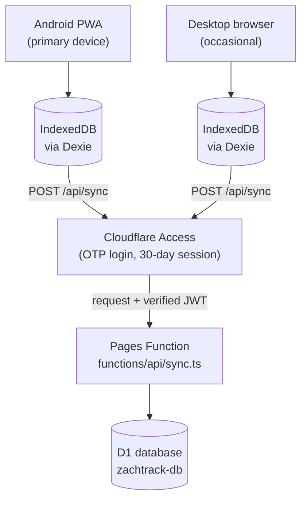

# ZachTrack - Architecture & Project Notes

This is the "reassociate yourself with the project" document. `README.md`
covers what the app does and how to run it; this file covers **why it's
built the way it is**, the sync architecture end-to-end, real issues hit
during implementation (and their fixes), the exact Cloudflare resources that
exist today, and what's been discussed but not built yet.

## 1. System overview

ZachTrack is local-first: every read/write goes through Dexie (IndexedDB) on
the device, and the UI never blocks on the network. A separate sync layer
pushes/pulls against a private Cloudflare backend, gated by Cloudflare
Access so the app and its data are invisible to anyone but the owner.



Nothing reaches `sync.ts` or D1 without first passing Cloudflare Access's
login check on the app's custom domain (`app.example.com` in these docs) - there is no separate
username/password/session system in application code at all.

## 2. Data model (current, exact)

From `src/lib/db.ts`. Every syncable record now carries a stable id and an
`updatedAt` used for last-write-wins conflict resolution.

```ts
interface FastRecord {
  id?: number;          // Dexie's local auto-increment id -- NOT synced, NOT globally unique
  uuid: string;         // stable id used for sync (added specifically to support this)
  startTime: number;
  startDay: number;     // start-of-day(startTime); app-level one-fast-per-day uniqueness
  endTime?: number;
  method: 'preset' | 'custom';
  presetId?: string;
  presetLabel?: string;
  targetHours?: number;
  moodRating?: number;
  energyRating?: number;
  hungerRating?: number;
  tags?: string[];
  note?: string;
  createdAt: number;
  updatedAt: number;
}

type FieldKind = 'number' | 'rating' | 'boolean';
type FieldAggregation = 'sum' | 'average' | 'last';  // how same-day entries combine for charts/stats; undefined = 'last'

interface FieldDefinition {
  id: string; name: string; kind: FieldKind;
  unit?: string; ratingMin?: number; ratingMax?: number;
  aggregation?: FieldAggregation;
  createdAt: number;
  updatedAt: number;    // added for sync; editable via updateFieldDefinition (aggregation only, today)
}

type TrackableDisplayMode = 'occurrences' | 'ages';

interface TrackableDefinition {
  id: string; name: string; icon: string; color: string;
  fieldIds: string[];
  displayMode?: TrackableDisplayMode;  // 'ages' = people/birthdays, see Section 3.9
  createdAt: number;
  updatedAt: number;
}

interface TrackableEntry {
  id: string; trackableId: string; timestamp: number;
  note?: string; tags?: string[];
  values?: Record<string, number | boolean>;
  createdAt: number;
  updatedAt: number;
}

interface SettingsRecord {
  id: 'app-settings';
  defaultPresetId: string; notificationsEnabled: boolean;
  heightInches?: number; goalWeightLb?: number;
  updatedAt: number;      // added for sync
}
```

**Sync-support-only tables** (never surfaced in any UI, purely plumbing):

```ts
/** Short-lived local record of a hard delete, kept only until the server acks it. */
interface SyncTombstone {
  id?: number;
  recordType: 'fasts' | 'fieldDefinitions' | 'trackableDefinitions' | 'trackableEntries';
  uuid: string;
  deletedAt: number;
}

/** Singleton row tracking this device's pull cursor. */
interface SyncMeta {
  id: 'sync';
  cursor: number;        // last server-assigned serverSeq this device has seen
  lastSyncedAt?: number;
}
```

Dexie is at schema **version 4**. Version 4's migration backfills `uuid` for
existing fasts and `updatedAt` for existing field definitions/settings -
additive, no data loss, same pattern as the v2 `startDay` migration before
it.

The **D1 (remote) schema** (`d1/schema.sql`) mirrors these almost exactly,
with the same field names (camelCase, not snake_case - a deliberate choice
so the wire format, local Dexie shape, and D1 columns all match 1:1 with
minimal translation code). Two differences worth knowing:
- Every D1 table adds `deletedAt` (soft-delete) and `serverSeq` (sync
  ordering) columns that have no local Dexie equivalent - see Section 3.6.
- `TrackableEntry.values` is stored in the `fieldValues` column server-side,
  because `VALUES` is a reserved SQL keyword. The sync endpoint's wire
  format still calls it `values` and translates it at the boundary.

## 3. Why it's built this way

### 3.1 D1, not R2, for the backend store
A simpler "dump the whole IndexedDB as one JSON blob into R2" was
considered and rejected early on: R2 only supports whole-blob last-write-wins,
which risks silently losing changes if two devices edit *different* records
before either syncs. D1 allows per-record conflict resolution, and the data
is genuinely relational.

### 3.2 Cloudflare Access, not custom auth code
Single-user personal app - gate the whole custom domain behind Cloudflare
Access (Zero Trust) rather than write any password/session/JWT code. Access
handles the entire login UX (email one-time-PIN, no external identity
provider needed) and only lets the owner's email (`OWNER_EMAIL`) through.

The sync endpoint *also* checks identity itself, because Access does not
cover every hostname that can reach the Function (see 4.6). See Section 4.2:
the friendly `Cf-Access-Authenticated-User-Email` header turned out not to be
reliably injected for Pages Functions, so the check reads the
`Cf-Access-Jwt-Assertion` header (the raw signed JWT) instead, and verifies
it the way Cloudflare documents (see 4.11): RS256 signature against the
team's published keys, issuer, expiry, optional audience tag, and the email
claim against `OWNER_EMAIL`. If `OWNER_EMAIL` or `ACCESS_TEAM_DOMAIN` is not
set, every request is refused (fail closed).

### 3.3 Cloudflare Pages + Pages Functions, one project
`/api/sync` is a Pages Function, not a separate Worker project - one
deployable unit serves the static PWA and the sync endpoint together.
Deployed via **direct upload** (`wrangler pages deploy`), not a git-connected
project: a direct-upload Pages project can't be switched to git integration
later, and deploying by hand at release time keeps production on tagged
versions only.

### 3.4 Full-dataset push, not delta sync
The original plan called for the client tracking "what changed locally
since last push" and sending only that delta. In practice this added real
complexity (a second local cursor, clock-skew risk between two devices'
system clocks) for no real benefit at this app's realistic personal-use
scale (well under a few thousand records, ever). What actually got built:
**the client just pushes its entire current local dataset on every sync**,
and the server's per-record "upsert only if incoming `updatedAt` is newer"
logic naturally no-ops anything that hasn't changed. Simpler client code, one
fewer thing that can drift out of sync with reality.

The direct consequence of this choice: a single sync call can carry the
*entire* dataset (all 29 seeded field definitions, all trackables, etc.),
which is what caused the subrequest-limit bug in Section 4.1 - the fix there
(batching) is what makes full-dataset push viable at all.

### 3.5 Server-assigned sequence cursor, not a timestamp cursor
The *pull* side ("what changed on the server since I last looked") uses a
monotonically increasing integer (`serverSeq`, tracked in a single-row
`syncSeq` table, incremented atomically per write) rather than a wall-clock
timestamp. This sidesteps an entire class of subtle bugs from clock skew or
two writes landing in the same millisecond, which a timestamp-based cursor
would be vulnerable to. `updatedAt` (client clock) is still used for
last-write-wins comparison *between* two versions of the same record - that
part is unaffected.

### 3.6 Soft-delete on the server, hard-delete + short-lived tombstone on the client
This was a deliberate hybrid, not the tombstones-vs-soft-delete either/or
originally framed:
- **Locally**, every delete function in `db.ts` still does a real, immediate
  hard delete - exactly as before sync existed. This means **zero changes**
  were needed to any existing query/read path anywhere in the app (routes,
  components, charts) - a huge reduction in risk surface compared to making
  every local read filter out soft-deleted rows.
- Each hard delete also writes a row to the local-only `syncTombstones`
  table, which exists purely to tell the server "this was deleted" on the
  next push. Once the server acknowledges it, the tombstone is pruned.
- **On the server**, a delete is just an ordinary LWW-compared field update
  (`deletedAt` set, compared the same way as any other column) - no special
  delete endpoint or code path.
- When a device **pulls** a server-side delete it didn't originate, it
  performs a real local hard delete and does **not** write a new tombstone
  for it (that would just bounce the delete back and forth forever).

### 3.7 One-fast-per-day conflict handling
D1 has a real `UNIQUE INDEX` on `(startDay) WHERE deletedAt IS NULL` as a
last-resort safety net, but the actual conflict *avoidance* happens in
memory: one query fetches all current non-deleted `(uuid, startDay)` pairs,
then each incoming fast is checked against that map before being included in
the batch upsert (see 3.8 for why this is a map lookup and not a per-record
query). A genuine conflict (two different fasts claiming the same day) gets
excluded from the upsert and reported back in the sync response's `rejected`
array. The client surfaces this as a small warning `N` badge on the sync status
pill - deliberately **no automatic merge**; this is a rare-enough edge case
for a single personal user that a surfaced, manually-resolved conflict is
safer than guessing which side should win.

### 3.8 Batched D1 writes via a reserved sequence range
Every sync request that has records to write does, at most: one query to
reserve a contiguous block of `serverSeq` values (`UPDATE syncSeq SET value
= value + ? ... RETURNING value`), one query to fetch existing fast
`(uuid, startDay)` claims, and up to five `db.batch([...])` calls (one per
table) - regardless of how many records are actually being synced. This
exists because of a real production bug; see Section 4.1 for the story.

### 3.9 Ages/birthdays as a `displayMode` flag, not a new bespoke module
When asked to build a "track people's ages" feature, the alternative
considered was a dedicated module (like Fasting is dedicated and separate
from Trackables). Rejected in favor of extending the existing generic
system: `TrackableDefinition.displayMode?: 'occurrences' | 'ages'` is one
optional field; a "person" is just a `TrackableEntry` with `timestamp` =
birthdate and `note` = name - no new field-kind, no schema surgery. The
`'ages'` mode only changes *how a trackable's own detail/list/card views are
rendered* (skips occurrence charts/streaks, shows a sorted people list with
live age + birthday countdown instead) - everything else about
create/edit/sync is identical to any other trackable. This keeps faith with
the project's core Trackables principle: nothing about what can be tracked
is hardcoded.

### 3.10 Sync history on the status pill is per-device, not server-synced

Double-clicking/double-tapping the sync-status pill (`SyncStatus.svelte`)
shows the last 5 sync attempts on *that device* - timestamp, what was pulled
from the server (or the error), and any rejected records - read from
`syncStore.history`, which is persisted to that browser's `localStorage`
(key `zachtrack:sync-history`) so it survives reloads.

This is deliberately per-device rather than a shared, cross-device log: a
sync event ("pulled 2 entries at 3:04pm") describes that device's own
conversation with the server at that moment, and since the client always
pushes its full local dataset rather than a delta (see 3.4), there's no
meaningful "records pushed" count to log either - only what came back in
`pullChangesSince`'s response is worth summarizing. A true unified history
visible identically on every device would require a new server-side concept
(a logged/synced audit table), which is a bigger, separate feature - see
Section 6.

Each history entry with pulled changes is also expandable (tap the row) into
a plain-text, human-readable line per changed record - e.g. `Water: 12 oz --
Jul 30, 3:15 PM` for a trackable entry, or `Fast -- Jul 29, 11:00 PM to 7:15
AM` - built by `describePulledChanges()` in `sync.svelte.ts`, capped at 20
lines per sync with a "+N more" fallback. This is a *what changed to*
listing, not a before/after diff: computing an actual old-value -> new-value
diff would require `applyRemoteChanges()` in `db.ts` to capture each local
record immediately before it's overwritten, which is meaningfully more
invasive (touches the core sync-apply path for all five record types) and
was deliberately scoped out for now.

Records the server refused (a day conflict, or since 4.12 a record that fails
validation) are listed too: the warning badge on the pill has a tooltip, and
the history entry shows "N not synced" and, expanded, one amber line per record
with its name and the server's reason, e.g. `Nutrition entry, Oct 20, 9:00 AM:
Invalid record: values must be ...`. `utils/rejected.ts` names records from
the local tables (falling back to a short id), capped at 10 lines per sync;
the count is always exact. A refused record stays on the device and is pushed
again on every sync, so it keeps showing until it's fixed or deleted.

Double-click/double-tap (a click-count-within-a-time-window check) was
chosen over long-press for opening the history popover: long-press needs
manual pointer-down/up/cancel timers plus a movement-cancellation threshold
to avoid firing during a scroll, and can still trigger Android's native
text-selection/callout UI depending on the browser - double-click/tap only
needs to count ordinary `click` events, which fire consistently for both
mouse and touch across every browser and PWA context.

The pill's "time ago" label is also now driven by a small
`setInterval`-driven tick in `SyncStatus.svelte`, not just recomputed when a
sync completes - without it, a `$derived` reading `Date.now()` never
re-evaluates purely from time passing, so the label used to get stuck (e.g.
permanently reading "just now") between sync events.

### 3.11 Tables first, charts second, for every data view

Smoothed multi-axis line charts made it hard to read actual values or to
see whether two metrics moved together. They also hid which points were
real readings and which were interpolated across unlogged days. Every
analytics surface now leads with a table and keeps its chart behind a
Table/Chart toggle:

- **Data tab** (`Charting.svelte`, route still `/charting`, nav label
  "Data"): the chips select table columns (and chart series). The table
  view has Day/Week/Month granularity.
- **Journey**: a fasting table replaces the old overlay chart, which
  duplicated the Data tab. The fasting-only charts (zones, heatmap,
  histogram, day-of-week) stay.
- **TrackableDetail**: a Trends table (entries per period, one column per
  attached field, BMI next to Weight when height is set), with the old
  "Fields over time" chart as the toggle. The entries list is now a real
  table (one row per entry, one column per field) instead of just a
  timestamp and note.

All three share one pipeline, `src/lib/utils/metrics.ts`. It builds a
"metric catalog" (per-day `Map`s plus metadata, reusing
`computeFieldValuesByDay` from 4.7), and `DataTable.svelte` renders it.
The table and chart can't disagree because they read the same catalog.
Decisions baked in:

- **Rows = periods (newest first), columns = metrics.** Read down a column
  for a trend and across a row for correlation. The header row and date
  column stay fixed while you scroll the table sideways, to fit the
  `max-w-md` layout.
- **Period rollup per metric** (`PeriodRollup`): `mean` over *logged days
  only* for point-in-time fields and for `sum` fields' daily totals, so
  weekly Calories reads as "avg/day", not a week total. `count` for
  occurrences (an unlogged day really is 0). `percent` of logged days for
  booleans. `last` (carried forward) for cumulative fasting hours.
- **Second line in each cell**: in Day view, a trailing 7-day average
  (mean metrics need 2+ readings in the window). In Week/Month view, the
  change vs the previous period. Changes are **neutral** (^/v, no
  red/green), because whether "up" is good depends on the field. Making
  them direction-aware would need a new `FieldDefinition` property, and so
  a schema/sync change.
- **Footer**: Avg, Change (first -> last period), and Per wk, a
  least-squares slope over the range's daily values. The slope doesn't
  depend on granularity and isn't thrown off by one outlier at either end.
- **Cell shading** by each column's relative magnitude (neutral as well:
  stronger tint = higher value, not better). **Copy** puts TSV on the
  clipboard, so it pastes cleanly into a spreadsheet. CSV file export was
  considered and dropped as unnecessary.
- Selected columns, range, granularity and Table/Chart view persist per
  device in `localStorage` (`zachtrack:data-view`, `zachtrack:journey-view`,
  `zachtrack:trackable-view`), same reasoning as 3.10: display preferences,
  not data, so they aren't synced.
- The remaining line charts use straight segments with a marker on every
  real reading (`smooth: false`, `showSymbol: true`). They still connect
  across unlogged days so sparse series (e.g. weekly weigh-ins) read as a
  line and not scattered dots.

No Dexie or D1 schema changes were involved.

### 3.12 Nightly backups as restore-ready SQL in R2
Pages projects can't run on a schedule, so backups are a separate Worker
(`workers/backup/index.ts`) with only a `scheduled` handler, `workers_dev =
false` and no routes: nothing can call it. It shares the D1 database through
its own binding and writes to a private R2 bucket in the same account, so the
data never leaves it.

The file is SQL rather than JSON so restoring needs no tool beyond
`wrangler d1 execute --file`:
- `UPDATE syncSeq SET value = MAX(value, <backup's value>) + 1`, then for
  each app table `DELETE FROM` and one `INSERT` per row with named columns
  (live tables that gained columns via `ALTER TABLE` have a different column
  order than `d1/schema.sql`; named columns make that irrelevant).
- Every restored row's `serverSeq` is the new `syncSeq` value. Devices only
  pull rows above their cursor, so without this a restore would be invisible
  to devices that had synced since the backup (the same reason the duplicate
  cleanup described in section 5 does).
- One statement per line: newlines inside text become `' || char(10) || '`,
  so a note containing `;` and a newline can't split a statement.
- No `BEGIN`/`COMMIT`: D1 refuses explicit transactions in executed SQL.

Retention is an R2 lifecycle rule (30 days), not code, so a failing Worker
can't also fail to clean up. A failed run throws, which marks the cron run
failed in the Worker's dashboard. `tests/backup.test.ts` restores a backup
into a second local D1 and compares every table, including text with quotes,
`;` + newline, CRLF and emoji; the same round trip was run once against a copy
of the real database (all 237 rows identical).

### 3.13 Export and import are a merge, never a replace
Profile > Your data exports every record on the device as one JSON file
(`src/lib/dataFile.ts`, format `zachtrack-export` version 1; fasts without
Dexie's local `id`). Import is deliberately not a restore:
- **Checked first, written after a confirm.** `planImport` validates every
  record with the same `src/lib/validate.ts` the sync endpoint uses, then
  works out what would change and shows it (added / updated / unchanged /
  skipped with reasons). Nothing is written until the user confirms.
- **Same rules as sync.** A record is taken only if it is new here or its
  `updatedAt` is newer, so importing an old file over newer data changes
  nothing and importing the same file twice is a no-op. A fast on a start
  day another fast owns is skipped (the server would reject it anyway), and
  an entry whose trackable is neither on the device nor in the file is
  skipped rather than written invisible.
- **Never deletes**, and carries no deletes: a record missing from the file
  stays. Rolling a device back to a file means clearing its site data first.
- **Then it syncs.** `importRecords` writes through `applyRemoteChanges` and
  then fires the local-mutation hook, so the next sync pushes the imported
  records like any edit. Settings from a file apply over a fresh device's
  defaults because those are created with `updatedAt: 0` (4.13).
- The plan is kept in `$state.raw`: a deep `$state` proxy can't be cloned into
  IndexedDB (4.4), which a browser check of the first version hit.

Server-side backups (3.12) are the disaster recovery; this is the user's own
copy, independent of Cloudflare, and the way a local-only install moves to a
new device.

## 4. Issues hit during implementation, and how they were resolved

These are real bugs that shipped and got fixed during this project's build,
not hypotheticals - worth knowing about if similar symptoms ever reappear.

### 4.1 Cloudflare's free-tier 50-subrequest-per-request limit
The first working version of `/api/sync` did 2-3 separate D1 queries **per
record** (a pre-check `SELECT`, a sequence increment, an `INSERT`). Combined
with full-dataset push (3.4) and the ~37 records already seeded locally
before sync even existed (29 field definitions + 8 trackables), the very
first real sync attempt needed 100+ D1 round trips in one request - but
Cloudflare Workers' free plan allows only 50 *subrequests* per request. The
sync consistently failed partway through with no useful client-side error.
Fixed by the batching design in 3.8: a bulk sequence reservation instead of
one increment per record, and `ON CONFLICT ... DO UPDATE ... WHERE
excluded.updatedAt > table.updatedAt` (pushing the last-write-wins check into
the SQL itself) instead of a separate pre-check query, so an entire table's
worth of records becomes one `db.batch()` call.

### 4.2 `Cf-Access-Authenticated-User-Email` isn't reliably injected for Pages Functions
The original plan assumed the sync endpoint could just read this
convenience header. In production it was always empty for this Pages
Functions + custom-domain setup - confirmed by temporarily deploying a
`/api/debug` endpoint that echoed back every header Cloudflare actually
sent. What *is* reliably present is `Cf-Access-Jwt-Assertion` (the raw,
signed JWT). Fixed by reading the `email` claim from that JWT. The first
version only decoded it without checking the signature; see 4.11 for why
that wasn't enough and what replaced it.

### 4.3 `fetch()` + cross-origin redirect on session re-challenge -> CORS error
When an Access session is stale/unrecognized, Access responds with a `302`
to `<team>.cloudflareaccess.com` to restart the login flow. A plain
`fetch()` follows redirects by default, and following this particular one
cross-origin gets blocked by the browser's CORS check (that login page isn't
built to be fetched via AJAX). This surfaced to the user as a confusing raw
CORS error with no actionable message. Fixed in the sync store by setting
`redirect: 'manual'` (turns it into a detectable `response.type ===
'opaqueredirect'` instead of an exception) and `credentials: 'include'`
(don't rely on the browser's default credentials mode), then showing a
clear "reload the page to log in again" message when that happens.

That message turned out to be wrong advice for the installed PWA - see 4.9
for why a reload can't actually trigger a re-login, and what replaced it.

### 4.4 Svelte 5 `$state` arrays/objects are Proxies - `DataCloneError` in IndexedDB
`$state([])` returns a reactive **Proxy**, not a plain array. The browser's
structured-clone algorithm (used internally by every IndexedDB write) cannot
clone a Proxy, even an empty one. This silently broke two features:
creating a new trackable (its `fieldIds` was an empty-but-reactive array)
and adding a tag to a fast (its `tags` array only became non-empty, and
therefore only hit this bug, once a tag was actually added). Neither save
handler had `try/catch`, so the failure was a totally silent no-op from the
user's perspective - no console was open, nothing appeared to happen at all.
Fixed by spread-copying (`[...tags]`, `[...fieldIds]`) immediately before
handing values to any `db.ts` function - a shallow copy is enough since the
arrays only ever contain primitive strings - and by adding `try/catch` +
visible on-screen error messages to every save handler that was missing it.

### 4.5 Dexie 4 has no built-in `db.on('changes', ...)`
The original plan assumed this event existed and could be the sync trigger
hook. It doesn't, without the separate `dexie-observable` addon (which
carries real Dexie-4-compatibility risk and wasn't installed). Replaced with
a small custom mechanism in `db.ts`: `onLocalMutation(listener)` /
`notifyMutation()`, called explicitly at the end of every exported mutating
function (`addFast`, `updateTrackable`, etc.) - since every local write
already funnels through this file's exported functions anyway, this is a
more explicit, dependency-free equivalent.

### 4.6 `<project>.pages.dev` exists alongside the custom domain
Every Cloudflare Pages project gets a `<project>.pages.dev` URL, plus a
`<hash>.<project>.pages.dev` alias per deployment, that exist regardless of
any custom domain. An Access application on the custom domain does not cover
them, so requests there reach the Function with whatever headers the caller
sent. Two layers close this:
- The sync endpoint verifies the Access JWT's signature (4.11), so a request
  without a token Access really issued is refused on every hostname.
- Access itself covers those hostnames too: Pages project > Settings >
  "Enable access policy" (covers `*.<project>.pages.dev` previews), plus
  `<project>.pages.dev` added to the Access application. Then the static app
  shell isn't reachable there either. (The shell holds no personal data; the
  data lives in each device's IndexedDB and in D1, never in the JS bundle.)

### 4.7 Multiple same-day trackable entries silently overwrote each other in charts/stats
Both `computeFieldSeries` (`trackableStats.ts`, backing `TrackableFieldsChart`)
and an inline duplicate in `Charting.svelte` built a `Map<day, value>` by
calling `.set()` once per entry with no accumulation, so logging e.g. Water
four times in a day left only whichever entry was processed last visible in
graphs/derived stats -- even though every entry was still correctly stored
and listed on the trackable's detail page. Fixed by adding an explicit
`aggregation: 'sum' | 'average' | 'last'` to `FieldDefinition` (per-field,
user-editable via a new `updateFieldDefinition()` in `db.ts` and a selector
in `EditTrackableSheet.svelte`; defaults to `'last'` so behavior is
unchanged unless set) and a single shared `computeFieldValuesByDay` helper
that both call sites now use to combine same-day entries per that mode
instead of overwriting. A new `computeFieldTodayTotal` powers a "today"
total stat card on `TrackableDetail.svelte` for each `sum`-aggregated
attached field. Cumulative nutrition/activity fields (Calories, Protein,
Water, Steps, etc.) are seeded with `'sum'`; point-in-time fields (Weight,
BP, ratings, etc.) keep the pre-existing `'last'` behavior. Confirmed
working in production after deploying and letting the Dexie v5 upgrade
backfill `aggregation` on existing local field records.

### 4.8 Native `disabled` on the sync pill silently ate the second click of a double-click
The sync-status pill's history popover (3.10) is opened by two clicks within
a short window, but the button also had `disabled={syncStore.status ===
'syncing'}`. `doSync()` sets `status` to `'syncing'` synchronously (before
its first `await`), so the very first click of a double-click disabled the
button in the same tick -- and a disabled `<button>` stops dispatching
`click` events entirely in every browser. The second physical click of the
double-click/double-tap was silently swallowed, so it looked exactly like a
plain single click (it synced, no popover). Fixed by dropping the native
`disabled` attribute (replaced with `aria-busy` + a `cursor: wait` style for
the visual affordance only) -- safe because `syncNow()` already coalesces
concurrent calls via its `inFlight` guard, so a click landing mid-sync was
never actually harmful, just blocked.

### 4.9 The service worker made it impossible to re-login when the Access session expired
When the Access session finally expired on the installed Android PWA, sync
failed with the 4.3 message telling the user to "reload the page to log in
again" - but reloading (or force-closing and relaunching) the PWA did
nothing, and there was no way out short of clearing the site's storage.

Root cause: `vite-plugin-pwa`'s generated service worker registers a Workbox
`NavigationRoute` bound to the precached `index.html` with **no denylist**,
so *every* same-origin navigation is answered from the cache without ever
touching the network. Cloudflare Access only ever gets to run its login flow
on a top-level navigation that actually reaches the edge - and none did. The
only network request the app made was the `fetch('/api/sync')`, which Access
answers with a 302 that a `fetch()` cannot meaningfully follow. Worse, the
same fallback would also have swallowed Access's own
`/cdn-cgi/access/callback` redirect (it lands on the app origin), so even
logging in via the team domain's App Launcher couldn't set the app cookie.
A further consequence: the service worker's own update check (`GET /sw.js`)
is also gated by Access, so once the session has expired a device *cannot
pick up a new deployment* until it has re-authenticated once by other means
(on Android Chrome: `chrome://serviceworker-internals` -> Unregister for the
origin, then relaunch; this leaves IndexedDB intact, unlike "Clear & reset").

Fixed in three parts:
- `vite.config.ts`: `navigateFallbackDenylist: [/^\/api\//, /^\/cdn-cgi\//,
  /[?&]reauth=/]` - Cloudflare-owned paths and the re-auth marker below are
  never served the app shell.
- `sync.svelte.ts`: the sync request now sends `X-Requested-With:
  XMLHttpRequest`, which Access documents as making an expired session
  return a plain `401` instead of a 302 (the `opaqueredirect` check is kept
  as a fallback). Either result maps to a dedicated `'unauthenticated'`
  status rather than a generic error. A new `reauthenticate()` does
  `window.location.assign('/?reauth=<ts>')`: because that URL is denylisted
  from the fallback, the navigation reaches the edge, Access redirects to
  the login page (in a Chrome Custom Tab from the standalone PWA - same flow
  as first install), the callback sets the cookie, and the user lands back in
  the app. `init()` strips the marker via `history.replaceState` afterwards so
  a later reload of that URL is offline-capable again.
- `SyncStatus.svelte`: when unauthenticated the pill reads "Login expired"
  and always shows a "Log in again" button (no need to expand). Tapping the
  pill itself still retries the sync, since a login done in a regular Chrome
  tab shares the cookie jar with the PWA and would just succeed.

### 4.10 Day stepping by `DAY_MS` drifted off midnight across DST
Per-day series were built as `rangeStart + i * DAY_MS`, and
`rangeStartFor` computed `today - n * DAY_MS`. Across a daylight-saving
change those land at 23:00 or 01:00 instead of local midnight, so the
`startOfDay`-keyed lookups silently missed and showed empty days on one
side of the DST boundary. Found while building the data tables (3.11). All
day stepping now goes through `addDays()` in `time.ts` (calendar
arithmetic via `Date.setDate`), including `rangeStartFor`,
`computeFieldSeries`, `computeOccurrenceBuckets`, and both heatmap
builders.

The streak counters (`computeFastStats`, `computeOccurrenceStats`) and
`filterSinceRange` were missed by that pass and still stepped by `DAY_MS`:
a streak broke at every DST change, and the 7-day filter could drop an entry
logged just after midnight on the range's first day. Found by the tests in
`tests/time.test.ts` (which fail on the old code) and fixed the same way.

### 4.11 The Access JWT was decoded but not verified
The first identity check (4.2) base64-decoded the JWT payload and trusted
its `email` claim, on the assumption that Cloudflare strips a client-supplied
`Cf-Access-Jwt-Assertion` header before it reaches the Function. Cloudflare's
own guidance is to validate the token in the origin, and the hostnames Access
doesn't cover (4.6) are exactly where a forged header would matter. A test
against the old handler confirms it returned the full dataset for a token with
a made-up signature. `server/access.ts` now verifies the token (RS256 via
WebCrypto, keys from `https://<team>/cdn-cgi/access/certs`, cached for an hour
and refetched on an unknown `kid` for key rotation, see 4.12), and the endpoint
fails closed when it isn't configured. `tests/access.test.ts` and
`tests/sync.test.ts` cover forged, foreign-key, expired, wrong-issuer,
wrong-audience and wrong-email tokens. The key format was checked against a
live team's certs endpoint (two RS256 keys with `kid`, `n`, `e`).

### 4.12 Hardening after a production security review (2026-10-21)
A passive review of the live deployment (headers, every hostname, the code)
found no data exposure, and these hardening gaps, fixed together:
- **Key refetch flood:** an unknown `kid` forced a certs fetch on every
  request, so tokens with made-up kids could turn each request into an extra
  subrequest. A forced refresh now happens at most once per 5 minutes; a
  failed certs fetch returns 503 instead of throwing.
- **One bad record failed every sync:** D1 rejects a whole `db.batch()` if
  one statement fails, so a single malformed record (a client bug binding
  `undefined` to a NOT NULL column) would have made every later sync fail.
  `src/lib/validate.ts` (shared with the app's import, 3.13) now checks every record against the schema first;
  failures are skipped and reported in `rejected`, like day conflicts, and
  the rest of the batch is stored. Checked against a copy of the real
  database: all 190 live records pass. Unknown tombstone types (including
  `__proto__`) are rejected instead of reaching the SQL builder.
- **Deleted rows kept their content:** a delete only set `deletedAt`. It now
  also clears notes, tags, ratings and values of fasts and entries (the row
  and `deletedAt` stay so other devices still learn about the delete).
  `d1/scrub-deleted.sql` applies the same clearing to rows deleted before
  this change.
- **No security headers:** `public/_headers` sets a strict CSP (only
  same-origin scripts, styles, images, connections and workers;
  `frame-ancestors 'none'`), `X-Frame-Options`, `Permissions-Policy`, HSTS
  and COOP for static assets, and sync responses are `Cache-Control:
  no-store`. Verified locally with `wrangler pages dev`: every tab and the
  SVG charts render with no CSP violations.

### 4.13 A new device reset everyone's settings
`getSettings()` created the default settings on first launch with
`updatedAt: Date.now()`. Because the client pushes its full dataset (3.4) and
the server keeps the newer `updatedAt`, a fresh install's first sync made
those defaults win and replaced the height, goal weight, default method and
notification setting every other device had synced. Defaults are now created
with `updatedAt: 0`, so any real edit beats them, locally and on the server.
`tests/settings.test.ts` (real `db.ts` on `fake-indexeddb`, real sync endpoint
on a local D1) fails on the old code. General rule: a record the app creates
on its own, rather than from a user edit, must not carry a current
`updatedAt`.

### 4.14 Synced settings didn't show until the app restarted
Every screen reads its data through Dexie `liveQuery`, so records a sync pull
or an import writes show up at once. The settings store was the exception: it
read the settings row once at startup, so a height or goal weight synced from
another device (or imported) was stored but not shown, and BMI and the goal
line used the old values until the app was restarted. The store now follows
the settings row with `liveQuery` too. Found by the browser test that imports
sample data and then checks the Profile sheet (`e2e/app.spec.ts`), which fails
on the old store.

### 4.15 The fasting streak read 0 every morning
`computeFastStats` built streak days from completed fasts only, so with a fast
every evening the current streak dropped to 0 each morning while last night's
fast was still running, and came back when it ended. A running fast now counts
for the day it started; totals, averages and the longest fast still count
completed fasts only. Spotted in the README screenshots of sample data, then
covered by tests in `tests/time.test.ts` that fail on the old code.

## 5. Infrastructure inventory

The deployment's real values (account, database id, domains, owner email)
are kept out of the repo, in the git-ignored `wrangler.toml` and a local
`infra.local.md`. The shape of the deployment:

- **D1 database:** `zachtrack-db`. Schema lives in `d1/schema.sql`; apply it
  to a new database with
  `wrangler d1 execute zachtrack-db --remote --file=./d1/schema.sql`, and use
  `--command="ALTER TABLE ..."` for incremental additive changes (as was
  done for the `displayMode` and `fieldDefinitions.aggregation` columns).
- **Pages project:** `zachtrack`, production branch `main`, deployed via
  **direct upload** (`npm run build`, then `wrangler pages deploy dist
  --project-name=zachtrack --branch=main`). Default URL
  `zachtrack.pages.dev` (see 4.6). The build bakes `package.json`'s version
  into the app (`__APP_VERSION__`, shown at the top of the Profile sheet), so
  after a deploy each device shows which build its service worker is serving;
  a device still on the old number needs the app closed and reopened.
- **Custom domain:** attached to the Pages project (dashboard-only step).
- **Cloudflare Access:** one self-hosted Access application covering the
  whole custom-domain hostname (no path restriction), plus the `pages.dev`
  hostnames (4.6), with a single "Owner only" policy allowing the owner's
  email, identity via Cloudflare's built-in One-Time-PIN email login (no
  external IdP), 30-day session duration.
- **`wrangler.toml`** (copy of `wrangler.toml.example`): D1 binding `DB` ->
  `zachtrack-db`; plain (non-secret) vars `OWNER_EMAIL`,
  `ACCESS_TEAM_DOMAIN` and optionally `ACCESS_AUD`, read by
  `functions/api/sync.ts`.
- **Backups:** D1's built-in Time Travel is always-on with no setup -
  point-in-time restore to any minute within the last **7 days** on the
  free plan (30 days on a paid plan). Beyond that, the `zachtrack-backup`
  Worker (`workers/backup/`, its own git-ignored `wrangler.toml`) writes a
  nightly restore-ready SQL file to the private R2 bucket `zachtrack-backups`,
  kept 30 days by a lifecycle rule. See 3.12 for the format. Still take a
  manual `wrangler d1 export zachtrack-db --remote --output=<file>` right
  before any schema change or migration, and keep the file outside the repo
  (it is health data; `*.sql` other than `d1/schema.sql` and
  `d1/scrub-deleted.sql` is git-ignored).
- **Never hard-delete rows in D1 by hand.** A row removed with `DELETE`
  leaves no `deletedAt` marker, so any device that still has the record
  pushes it straight back on its next sync. That is how a duplicate starter
  set created on 2026-07-28 reappeared on 2026-10-21. To remove records, set
  `deletedAt` and `updatedAt` to now and `serverSeq` to a fresh value from
  `syncSeq`, so every device pulls the delete.

## 6. Deferred / discussed but not built

Nothing here is committed to - this is a memory aid for "we talked about
this," not a promise.

- **Tag visibility + filtering (agreed design, not yet built):** tag chips
  shown on each fast (`History.svelte`) and each trackable entry
  (`TrackableDetail.svelte`), plus a single-tag filter bar above each list
  (tap a tag to narrow the list, tap again/"All" to clear). Scoped
  deliberately small: filters only the raw list, not the charts above it on
  `TrackableDetail`; no tag rename/management tooling; filter state doesn't
  persist across navigation. A "tap a tag badge on a row to also filter by
  it" nice-to-have was floated but not decided on.
- **Cross-cutting tag browser ("Option B"):** a dedicated view showing every
  fast *and* every trackable entry across the whole app that shares a given
  tag, in one combined timeline - useful for correlation-spotting (e.g. "what
  happens when I'm tagged 'stressed'"), but a bigger build: new
  route/aggregation logic across two tables, and a nav-placement decision.
- **Tag-aware Charting filters ("Option C"):** letting Charting's per-day
  aggregated series be restricted to only tagged occurrences. Conceptually
  the most powerful of the three tag ideas (fits Charting's whole
  correlation-hunting purpose) but touches the data pipeline that builds
  chart series, not just a rendered list - separate scope from the other two.
- **Push notifications:** true background Web Push (server-triggered, works
  with the browser fully closed) was explicitly called out as a natural
  future pairing with sync, but is out of scope for now. The existing
  `notifications.ts` only does foreground/backgrounded-tab local
  notifications.
- **Age-tracker extras:** a relationship label (e.g. "Mom", "Friend") per
  person was considered; decided name + age is enough for now.
- **Direction-aware trend colors in data tables:** a per-field "higher is
  better / lower is better" setting so ^/v could be colored green/red.
  Deliberately left neutral for now (3.11) because it needs a new
  `FieldDefinition` property, and so a D1 schema and sync change.
- **Correlation hints:** e.g. a Pearson coefficient between two selected
  Data-tab columns. Floated as a follow-up to the tables. Not built,
  because with small personal datasets it's easy to over-read.
- **Cross-device shared sync history/audit log:** the sync-status pill's
  history (see 3.10) is per-device (`localStorage`) by design. A unified
  log visible identically on every device - "what changed, from which
  device, and when" - was discussed as a possible follow-up, but would need
  a new server-side logged/synced table and isn't built.

## 7. Validation conventions

- After any non-trivial change: `npm run check` (must be 0 errors/warnings -
  it runs five checks: the Svelte app, the Vite/Vitest configs, everything
  under `functions/`, `server/` and `workers/`, the unit tests and the browser
  tests), then `npm test`, then `npm run build` (must succeed; the
  EChart-dependent lazy routes will always warn about chunk size - that's
  expected, not a regression), then `npm run e2e` for anything that touches
  the UI, sync client or service worker. CI runs the first three on Linux and
  Windows and the browser tests on Linux; the required `ci` check needs both.
- Browser tests (Playwright, `e2e/`, see `e2e/README.md`): the production
  build under `wrangler pages dev`, sample data imported through the real UI,
  and the service worker's re-login path (4.9). Any change to
  `vite-plugin-pwa` or the Workbox options must keep
  `service-worker.spec.ts` passing; emptying `navigateFallbackDenylist` makes
  four of its tests fail.
- Tests (Vitest, `tests/`): day math across DST (run in `America/New_York`),
  same-day aggregation and the metric table, Access JWT verification, and the
  sync endpoint end to end against a local D1 (workerd via Wrangler's
  `getPlatformProxy`) built from `d1/schema.sql`. For sync/D1 changes, also
  confirm with `wrangler d1 execute` queries against the real remote database
  that data landed as expected.
- Svelte 5 runes patterns: components use `$props()`/`$state()`/`$derived()`;
  cross-component shared state uses plain classes with `$state` fields as a
  singleton, in `.svelte.ts` files (required for runes outside `.svelte`
  files) - see `src/lib/stores/*.svelte.ts`, including `sync.svelte.ts`.
  **Never pass a `$state` array/object directly into a `db.ts` call** -
  spread-copy it first (Section 4.4).
- Cloudflare changes: prefer `wrangler` CLI over dashboard clicks wherever
  possible for reproducibility, but some things (custom domain attachment,
  the Access application/policy itself) are dashboard-only and were done by
  hand.
