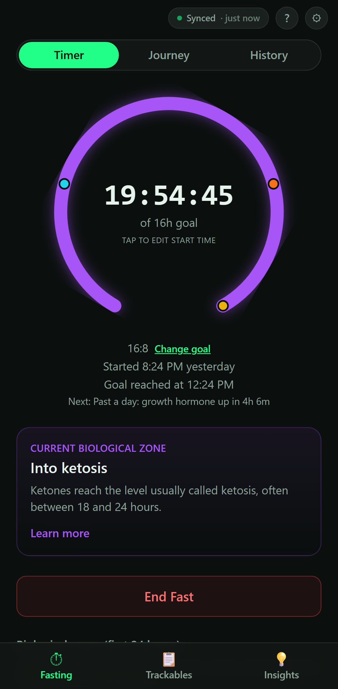
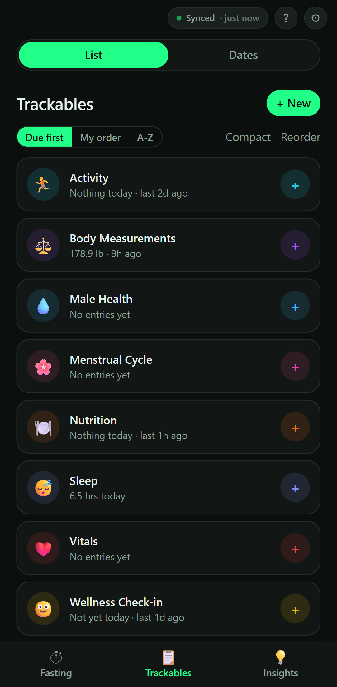
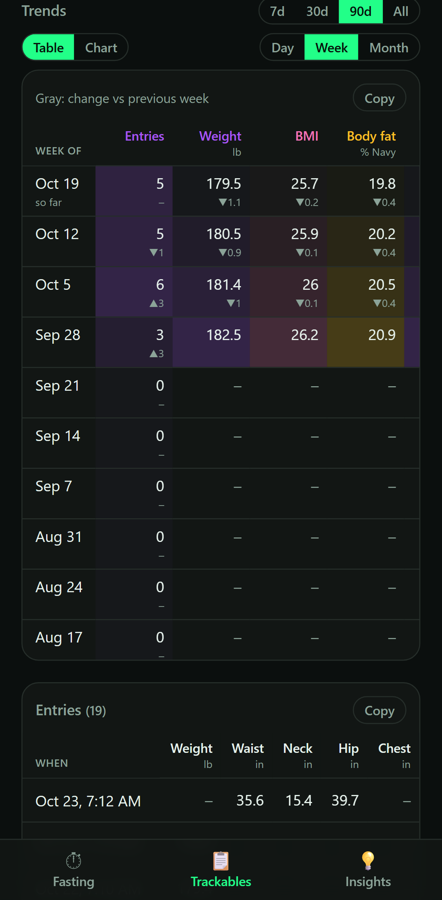
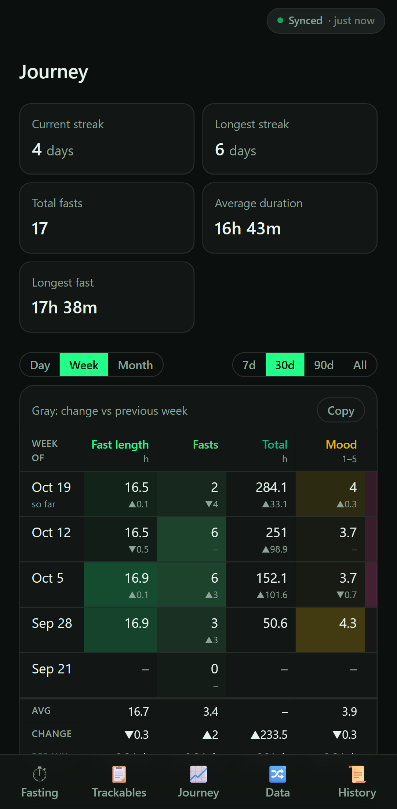

# ZachTrack

**A local-first fasting timer and "track anything" PWA, with private two-way sync through your own Cloudflare account.**

[](https://github.com/ZachGSnow/zachtrack/actions/workflows/ci.yml)
[](LICENSE)

<p>
  
  
  
  
</p>

<sub>Fictional sample data, captured from the real app with <code>npm run screenshots</code>.</sub>

## Why

Fasting apps and habit trackers each hold one slice of the picture, usually in
someone else's cloud. ZachTrack keeps fasts, body measurements, nutrition,
sleep, mood and anything else you define in one installable app that works
offline. Your data lives on your devices and in a D1 database in your own
Cloudflare account, behind Cloudflare Access, with no login code of its own.

## Features

- **Fasting timer** with preset methods (16:8, 18:6, OMAD and more) or count-up,
  a gauge ring with tappable metabolic-zone markers, and one fast per start day.
  Save fast lengths of your own (15:9, 36 hours...) next to the presets.
  Start a fast you forgot to start (30m, 1h, 2h ago or a time), see the start,
  goal and next zone under the timer, change the goal mid-fast, and end with a
  summary of how it went against the goal. Milestones show in the app, never as
  notifications. Between fasts the tab shows the eating window, and History
  logs a fast you didn't time. An optional daily start time counts down to
  your next fast, and a weekly plan gives each weekday its own method and
  time or a rest day. Long fasts get hydration and electrolyte prompts,
  cautions at 48 and 72 hours, and refeeding advice when they end. Journey has a goal streak (days a fast met its goal), this
  week against last, a habit grid of fasting days, and a weight-after-fasting
  insight next to the table and charts.
- **Trackables:** define anything to track, with number (optional unit),
  rating (custom scale) or yes/no fields. Each field chooses how several
  entries on one day combine (`sum` for Water, `last` for Weight, `average`).
  Each trackable leads with what matters for its kind, picked automatically
  from its fields and changeable: time since (events), latest value and
  change (readings like Weight), today's total (Calories, Water) or logged
  today with a streak (check-ins). Optional goals: a daily total, N times a
  week, every N days (with due and overdue) or avoid, each with its own
  streak; times per day too, and daily goals can apply on chosen weekdays,
  with days skipped or the goal paused for a holiday without breaking the
  streak. A trackable with a goal gets a habit-grid strip on its card and a
  check button for today; each trackable's page has the full grid by week,
  month, six months or year. A trackable without fields logs in one tap,
  with undo. The list
  sorts by what's due (or your own order, or A-Z), with pinning and
  archiving; fasts and entries can be filtered by tag. In-app reminders
  instead of notifications: a Needs attention list of overdue and due goals,
  and badges on the Trackables and Fasting tabs. Each trackable's page adds
  plain-language insights: goal consistency, best weekday, and how a value
  differs on days with your other trackables.
  A starter set (Body Measurements, Vitals, Nutrition, Sleep, Wellness,
  Activity, Menstrual Cycle, Male Health) is created on a new install and is
  fully editable, including each field's name, unit and rating scale.
- **Dates:** birthdays with live ages, anniversaries, holidays (including
  rules like the 4th Thursday of November, and Easter), and countdowns or
  renewals that repeat every few months or years, each with a countdown. A
  US holidays template adds the federal holidays and common observances.
  Dates show under Needs attention a few days ahead, the next two weeks
  under Coming up, and the next year on a Dates page with a list and a
  month calendar.
- **Tables first:** the Data tab, Journey and each trackable show rows per
  day, week or month with a 7-day rolling average or change vs the previous
  period, an Avg / Change / Per-week trend footer, and a Copy button that puts
  TSV on the clipboard. Each has a chart view (ECharts) behind a toggle.
- **BMI** derived from your weight field (chosen in Settings) and your height,
  and a **body-fat estimate** (US Navy method) from waist, neck and hip
  measurements logged together.
- **Help** in the app: Getting started and short guides to each feature,
  with "?" links where questions come up.
- **Phone and laptop layouts:** a tab bar on phones; on wider screens a
  sidebar, content that uses the width, and dialogs instead of bottom sheets.
- **Offline and installable** (service worker, Android/Chrome PWA), with
  home-screen shortcuts (long-press the icon): Start a fast, Trackables,
  Journey.
- **Two-way sync** across devices: per-record last-write-wins, deletes that
  propagate, conflicts reported instead of guessed, and a sync status pill.
  A Sync page lists your devices and their app versions, the activity on
  all devices for 90 days (names, never values), and 30 days of this
  device's syncs, including edits another device's newer one replaced.
  Check sync and Full resync to compare and repair; Sign out (Cloudflare
  ends the login on every device) and Sign out and erase this device.
- **Templates** for new trackables (Water, Workout, Weigh-in, ...), and a
  compact list view.
- **CSV export** for a spreadsheet, one row per value.
- **Export and import** (Settings > Your data): a JSON file of everything on
  the device, and an import that previews what it will add or update, merges
  by newest version, never deletes, then syncs.

US units only (lb, in, &deg;F).

## Quick start

Needs Node.js 22 or newer.

```bash
git clone https://github.com/ZachGSnow/zachtrack.git
cd zachtrack
npm install
npm run dev
```

Open the printed URL. Without a sync backend the app runs local-only: data
stays in the browser's IndexedDB, the starter trackables are created on first
launch, and the sync pill reads "Local only" instead of an error. Export and
import (Settings > Your data) move data between local-only installs.

## Deploy your own (Cloudflare)

Everything below fits Cloudflare's free plan. Each deployment is separate:
your data goes to your account only.

1. **Config:** `copy wrangler.toml.example wrangler.toml` (Windows) or
   `cp wrangler.toml.example wrangler.toml`. `wrangler.toml` is git-ignored.
2. **Database:** `npx wrangler d1 create zachtrack-db`, put the printed id in
   `database_id`, then apply the baseline schema and the migrations:
   `npx wrangler d1 execute zachtrack-db --remote --file=./d1/schema.sql`, then
   `npx wrangler d1 migrations apply zachtrack-db --remote`
3. **Pages project:** `npm run build`, then
   `npx wrangler pages deploy dist --project-name=zachtrack --branch=main`
   (the first run creates the project).
4. **Custom domain:** Pages > zachtrack > Custom domains (dashboard).
5. **Access:** Zero Trust > Access > Applications > add a self-hosted app for
   your custom domain **and** `zachtrack.pages.dev`, with one Allow policy for
   your email and the One-time PIN login method. Then Pages > zachtrack >
   Settings > enable the access policy for preview deployments
   (`*.zachtrack.pages.dev`).
6. **Vars:** set `OWNER_EMAIL`, `ACCESS_TEAM_DOMAIN` and (recommended)
   `ACCESS_AUD` in `wrangler.toml`, then build and deploy again.

**Deploying a release:** from a clean, pulled `main` at the release tag, run
`npm run deploy`. It backs up the database to a file outside the repo (your
OS temp folder, or `--backup-dir <dir>`), applies any new migrations from
`d1/migrations/`, builds, deploys to Pages, and checks the new deployment is
live and still behind Access. `npm run deploy -- --dry-run` runs only the
checks and the build. Before v1.6.0, schema changes were applied by hand:
coming from v1.3 or older, first add the v1.4.0 and v1.5.0 columns
(`settings.weightFieldId`, then `waistFieldId`, `neckFieldId`, `hipFieldId`,
`bodyFatSex`, all `TEXT`) with `ALTER TABLE ... ADD COLUMN`.

Install the app from your custom domain in Chrome (Add to Home screen).
Settings (the gear in the header; in the sidebar on a laptop) shows the version each
device is running. After a deploy, a device that still shows the old number
picks up the new one when the app is closed and reopened.

## Configuration

All values live in `wrangler.toml` (start from `wrangler.toml.example`).

| Setting | Required | What it is |
|---|---|---|
| `database_id` | yes | Your D1 database id (`wrangler d1 create` prints it) |
| `OWNER_EMAIL` | yes | The only email the sync endpoint accepts; must match your Access policy |
| `ACCESS_TEAM_DOMAIN` | yes | Your Zero Trust team domain, e.g. `your-team.cloudflareaccess.com` |
| `ACCESS_AUD` | recommended | The Access application's AUD tag (Access > Applications > your app > Overview) |

If `OWNER_EMAIL` or `ACCESS_TEAM_DOMAIN` is missing, the sync endpoint refuses
every request instead of running unchecked.

## Backups

D1 keeps point-in-time history for 7 days on the free plan. For longer,
`workers/backup/` is a small scheduled Worker that writes a restore-ready SQL
file of the whole database to a private R2 bucket every night at 09:00 UTC
(`zachtrack-db/YYYY-MM-DD.sql`). It has no public URL. A bucket lifecycle rule
deletes files after 30 days.

Set up once:

```bash
npx wrangler r2 bucket create zachtrack-backups
npx wrangler r2 bucket lifecycle add zachtrack-backups expire-30-days --expire-days 30
cd workers/backup
cp wrangler.toml.example wrangler.toml   # set database_id; git-ignored
npx wrangler deploy
```

Restore (replaces every row in the app tables):

```bash
npx wrangler r2 object get zachtrack-backups/zachtrack-db/2026-10-22.sql --remote --file=restore.sql
npx wrangler d1 execute zachtrack-db --remote --file=restore.sql
```

Restored rows get a new sync sequence number, so every device pulls them.
Devices then push their own local data as usual, and the newer version of each
record wins; to roll every device back too, clear the site data on each device
before it syncs again. The file is health data: keep it out of the repo and out
of synced folders, and delete it when done.

## How it works

- **Local-first:** every read and write goes through Dexie (IndexedDB). The UI
  never waits on the network.
- **Sync:** `POST /api/sync` is a Pages Function (`functions/api/sync.ts`) over
  D1. The client sends what changed since its last sync (everything on the
  first sync, after an import, and once a day); the server upserts each
  record only if its `updatedAt` is newer, in a few batched queries per
  request (under the free plan's 50-subrequest limit), and says what it
  stored. Pulls use a server-assigned sequence number as the cursor, so
  device clocks don't affect what gets pulled, and leave out what the
  request itself wrote. The app also syncs when it comes back into view or
  online, and every few minutes while open.
- **Auth:** Cloudflare Access does the login. The Function also verifies the
  Access JWT (RS256 signature against the team's published keys, issuer,
  expiry, audience, email), because `*.pages.dev` hostnames can reach it
  without Access (`server/access.ts`).
- **Input checks:** every incoming record is validated against the schema
  (`src/lib/validate.ts`); a bad one is skipped and reported back, and the
  rest of the sync goes through.
- **Headers:** `public/_headers` sets a strict Content-Security-Policy
  (same-origin only, no framing), HSTS and related headers; sync responses
  are never cached.

Stack: Vite, Svelte 5 (runes), TypeScript, Tailwind CSS 4, Dexie,
vite-plugin-pwa, ECharts, Cloudflare Pages + Functions + D1 + Access.

[ARCHITECTURE.md](ARCHITECTURE.md) covers the design decisions, the sync
protocol, the real bugs hit along the way and how they were fixed.

## Your data and privacy

- **What is stored:** fasts, trackable definitions, entries (values, notes,
  tags, timestamps) and settings (height, goal weight).
- **Where:** in each browser's IndexedDB, and, if you deploy the backend, in
  your own D1 database. Nothing is sent anywhere else. The app has no
  analytics.
- **In what form:** plain JSON in IndexedDB and plain rows in D1. D1 is
  encrypted at rest by Cloudflare; the app adds no encryption of its own.
- **Deleting:** deleting a record removes it locally and marks it deleted in
  D1 (`deletedAt`), so other devices delete it too. The server also clears a
  deleted fast's or entry's notes, tags, ratings and values; a small row with
  the id, dates and `deletedAt` stays. For rows deleted before v1.0.1, run
  `d1/scrub-deleted.sql` once. Clearing site data removes the local copy;
  dropping the D1 database removes the server copy. Neither is a secure erase,
  and D1 Time Travel keeps earlier versions for 7 days.
- **Per-device only:** sync history and view preferences stay in that
  browser's `localStorage`.
- **Export files** are plain JSON with all of the above in readable form.
  Keep them out of shared or synced folders and delete them when you no
  longer need them.

## Testing

```bash
npm run check   # svelte-check + tsc for the app, configs, Functions and tests
npm test        # Vitest
npm run build
npm run e2e     # Playwright browser tests (once: npx playwright install chromium)
```

CI runs the first three on Linux and Windows with Node 22 and 24, and the
browser tests on Linux. See [e2e/README.md](e2e/README.md).

**Verified by tests:**
- Day math across DST changes (run in `America/New_York`): streaks, ranges,
  calendar-day stepping. These tests failed on the earlier code and found real
  bugs.
- Same-day aggregation (`sum`, `last`, `average`) and the metric table rollups,
  rolling averages and TSV copy.
- Access JWT verification: valid tokens pass; forged, foreign-key, `alg: none`,
  expired, not-yet-valid, wrong-issuer, wrong-audience and wrong-email tokens
  fail; key caching, rotation, and at most one forced refetch per 5 minutes.
- The sync endpoint end to end against a local D1 built from `d1/schema.sql`:
  fail-closed config, round trip of every record type, last-write-wins,
  one-fast-per-day rejection, deletes vs newer edits, a 240-record push in
  one request, malformed records rejected one by one without failing the
  batch, unknown delete types skipped, content cleared on delete, and
  `d1/scrub-deleted.sql`.
- Backups: a backup restored into a second local D1 matches every table,
  including awkward text, and devices pull the restored rows.
- Export and import with the real `db.ts` on fake IndexedDB: a full restore
  onto a fresh device, merge by newest version, no deletes, re-import is a
  no-op, invalid / orphan / same-day records skipped; and a new device's
  default settings never overwrite synced settings.
- In a real browser on the production build (Playwright, Chromium): a
  local-only install, sample data imported through the UI and shown on every
  screen with no console or CSP errors, imported settings shown without a
  restart, "Login expired" and Log in again, refused records listed; and the
  service worker's re-login path: the app shell opens offline, while
  `?reauth=`, `/cdn-cgi/` and `/api/` navigations always reach the network.

**Verified by hand:**
- The Access certs format against a live team's `/cdn-cgi/access/certs`
  endpoint (RS256 keys that import with the same WebCrypto call the Function
  uses).
- Record validation against a copy of a real database: every live record
  passes.
- The CSP under `wrangler pages dev`: every tab and the charts render with no
  violations.
- Backup and export round trips on a copy of a real database: every record
  comes back identical.
- Export and import in the browser: export, then import a modified file;
  the preview, the skipped record and the imported entry all show correctly.

**Not verified by automated tests:** Access's own login and redirects (they
only exist on Cloudflare), real sync against a production server, and the
installed Android PWA. Those are checked by hand after a deploy.

## Health information

The fasting zone descriptions are general information, not medical advice.
Talk to a doctor before extended fasting.

## License

[MIT](LICENSE) &copy; Zach Snow
